# Predicción del puntaje de felicidad mediante modelos de regresión

## 1. Introducción

Este proyecto desarrolla un proceso reproducible de perfilado, transformación, análisis exploratorio y modelamiento supervisado de los datos del **World Happiness Report, ediciones de 2015 a 2019**. Su objetivo es estimar `happiness_score` a partir de seis indicadores comunes a los archivos históricos y comparar la capacidad de generalización temporal de cinco modelos de regresión.

El puntaje representa evaluaciones de vida en una escala de 0 a 10, obtenidas mediante la escala de Cantril en la Gallup World Poll. Los seis factores empleados para explicar diferencias entre países —PIB per cápita, apoyo social, esperanza de vida saludable, libertad, generosidad y percepción de corrupción— **no constituyen una fórmula de cálculo de la clasificación**. Véase la [metodología del World Happiness Report](https://www.worldhappiness.report/faq/).

La unidad analítica es el **registro país–edición**, identificado por `country` y `year`. En los cuadernos se denomina país–año; `year` identifica el archivo o edición y no garantiza que todas las mediciones originales se hayan recogido exclusivamente en ese año. Se conserva la denominación operativa «país» para las unidades geográficas del conjunto de datos, que también incluye territorios.

El alcance actual comprende preparación, análisis, entrenamiento por lotes y simulación de ETL de eventos con Apache Kafka e inferencia en Python. La arquitectura general se presenta en la sección 2; las partes B y C documentan el flujo de eventos y el almacén de predicciones.

## 2. Arquitectura del sistema


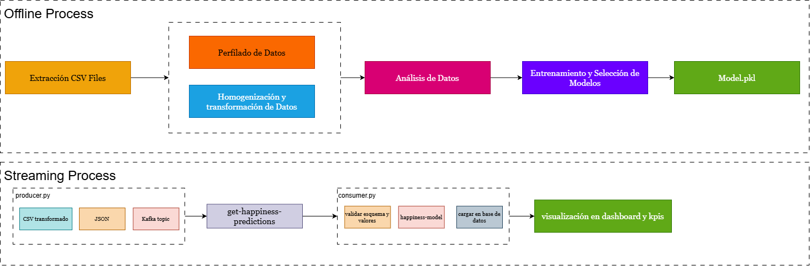

El procesamiento por lotes limpia los archivos históricos, genera los conjuntos analíticos y entrena el modelo. El productor publica cada observación en Kafka; el consumidor conserva el mensaje original en PostgreSQL, valida el contrato y aplica el modelo guardado. Las predicciones se almacenan en un esquema dimensional que Power BI consulta para analizar precisión, calidad del flujo y actividad temporal.

## 3. Conjunto de datos

Los archivos proceden de la recopilación [World Happiness Report en Kaggle, publicada por SDSN](https://www.kaggle.com/datasets/unsdsn/world-happiness), basada en los informes del World Happiness Report. Los originales se conservan en `data/raw/` y se consultan sin sobrescribirlos.

| Edición | Archivo original | Registros | Variables originales |
| --- | --- | --- | --- |
| 2015 | `data/raw/2015.csv` | 158 | 12 |
| 2016 | `data/raw/2016.csv` | 157 | 13 |
| 2017 | `data/raw/2017.csv` | 155 | 12 |
| 2018 | `data/raw/2018.csv` | 156 | 9 |
| 2019 | `data/raw/2019.csv` | 156 | 9 |

Se dispone de **782 registros**. Tras normalizar nombres se identifican **165 países o territorios distintos** y un panel completo de **146 unidades con observaciones en las cinco ediciones**. Las cantidades de variables de la tabla corresponden a los CSV originales, antes de incorporar `year` y homogeneizar esquemas.

### 3.1. Variables de trabajo

| Variable canónica | Función | Interpretación operativa |
| --- | --- | --- |
| `country` | Identificador | Nombre normalizado del país o territorio. |
| `year` | Identificador temporal | Año de la edición; define las ventanas de desarrollo y prueba. |
| `region` | Agrupación descriptiva | Región normalizada o completada; se utiliza en el análisis exploratorio. |
| `happiness_rank` | Variable descriptiva | Posición en la clasificación; se excluye como predictor porque deriva del puntaje. |
| `happiness_score` | Objetivo | Puntaje de evaluación de vida que se desea estimar. |
| `gdp_per_capita` | Predictor numérico | Indicador asociado al PIB per cápita. |
| `social_support` | Predictor numérico | Indicador asociado a la disponibilidad percibida de apoyo social. |
| `healthy_life_expectancy` | Predictor numérico | Indicador asociado a la esperanza de vida saludable. |
| `freedom` | Predictor numérico | Indicador asociado a la libertad para tomar decisiones de vida. |
| `generosity` | Predictor numérico | Indicador asociado a la generosidad. |
| `corruption` | Predictor numérico | Indicador asociado a percepción de corrupción y confianza institucional. |

Los campos numéricos se interpretan como **indicadores publicados en los archivos**. Pueden representar contribuciones estimadas por el informe; no deben leerse automáticamente como dólares, años de vida o proporciones de población. La homogeneización de nombres no demuestra equivalencia metodológica completa entre ediciones. Una asociación positiva de `corruption` con el objetivo no significa que una mayor corrupción produzca mayor felicidad.

## Parte A — Procesamiento por lotes

## 4. Perfilado de datos y decisiones de transformación

El [cuaderno de perfilado](notebooks/data-profiling.ipynb) examina estructura, tipos, nulos, duplicados, categorías y valores potencialmente atípicos. Los informes HTML por edición, generados mediante YData Profiling, se conservan en `data/reports/profile_2015.html` a `profile_2019.html`.

| Dimensión de calidad | Hallazgo verificado | Decisión aplicada |
| --- | --- | --- |
| Valores ausentes en campos publicados | Un nulo en `Perceptions of corruption` de United Arab Emirates, edición 2018. | Imputar con la mediana de los valores observados de 2018: **0,082**. Se conserva la fila. |
| Duplicados | Ninguna fila completamente duplicada en los originales; no se repiten claves país–año después de normalizar. | Conservar las filas y verificar unicidad de la clave. |
| Nombres de columnas inconsistentes | `Happiness Score`, `Happiness.Score` y `Score`; también `Family` frente a `Social support`. | Aplicar un diccionario semántico explícito y nombres comunes en `snake_case`. |
| Tipos de datos | Las columnas numéricas ya se leen como enteros o flotantes; no se identificaron fallos de conversión. | Validar con conversión numérica estricta; mantener año y rango enteros. No se atribuyen inconsistencias inexistentes a los datos. |
| Diferencias de esquema | Región solo en 2015–2016; error estándar en 2015; intervalos en 2016; límites de los intervalos en 2017; residuo de distopía en 2015–2017. | Consolidar indicadores comunes y eliminar los seis campos auxiliares detallados más abajo. |
| Ausencia estructural de región | Los **467 registros de 2017–2019** carecen de esa columna en sus archivos originales. | Completar **466** mediante el país normalizado y su región de 2015–2016; asignar Gambia mediante fuente geográfica externa. |
| Variantes de países | Cinco equivalencias de denominación afectan **10 registros**. | Unificar mediante diccionario antes del cruce regional; conservar diferenciados `North Cyprus` y `Cyprus`. |
| Formato regional | Se requiere una representación uniforme para agrupar. | Quitar espacios exteriores y repetidos; primera letra mayúscula y restantes minúsculas. Detener el proceso si un país tiene regiones contradictorias. |
| Precisión numérica | Diferente cantidad de cifras decimales, especialmente en 2017. | Redondear seis indicadores y objetivo a **tres decimales**, después de imputar, y exportar con tres cifras decimales. |
| Potenciales valores atípicos | Candidatos señalados mediante límites de **1,5 × rango intercuartílico**, por variable y edición. | Conservarlos: una observación extrema no constituye por sí misma un error. No se recortan ni winsorizan valores. |

### 4.1. Normalización de países y recuperación de regiones

| Denominación alternativa | Nombre canónico | Región recuperada del histórico |
| --- | --- | --- |
| `Taiwan Province of China` | `Taiwan` | `Eastern asia` |
| `Hong Kong S.A.R., China` | `Hong Kong` | `Eastern asia` |
| `Trinidad & Tobago` | `Trinidad and Tobago` | `Latin america and caribbean` |
| `Northern Cyprus` | `North Cyprus` | `Western europe` |
| `Macedonia` | `North Macedonia` | `Central and eastern europe` |

Las correspondencias aseguran continuidad de identificación entre archivos. Las regiones existentes se conservan. Para **Gambia**, sin antecedente regional en 2015–2016, se documenta la asignación a `Sub-saharan africa`: la [clasificación M49 de Naciones Unidas](https://unstats.un.org/unsd/methodology/m49/overview) la ubica en África Occidental, dentro de África Subsahariana. No se crea otra categoría.

La regla general conserva `Desconocido` cuando no existe correspondencia histórica ni asignación externa explícita. Actualmente quedan **cero regiones desconocidas**. La recuperación supone estabilidad de la clasificación regional durante el período; no equivale a una medición regional independiente en cada edición.

### 4.2. Validaciones de calidad con Great Expectations

Se incorporan tres reglas en [happiness_validation.py](gx/happiness_validation.py) para comprobar las decisiones de transformación y la trazabilidad después de la carga, sin modificar los datos:

| Etapa | Validación | Decisión que verifica |
| --- | --- | --- |
| Después de transformar | Combinación `country`–`year` sin duplicados en `happiness_analysis.csv`. | La normalización de países conserva la granularidad país–año. |
| Después de transformar | Regiones sin nulos, vacíos ni `Desconocido` en el histórico preparado. | La recuperación regional está completa para los datos actuales. |
| Después de cargar | Cada evento `VALID` tiene exactamente una predicción; los demás estados no tienen ninguna. La base debe contener predicciones. | Se mantiene la relación entre el original y el resultado, y se excluyen de predicción los eventos inválidos o fallidos. |

Con las dependencias instaladas, el CSV transformado disponible y la carga en PostgreSQL completada, ejecutar desde la raíz en **Git Bash**:

```bash
./.venv/Scripts/python.exe gx/happiness_validation.py
```


### 4.3. Productos y verificaciones

La transformación de [transform-data.ipynb](notebooks/transform-data.ipynb) produce:

| Archivo | Dimensión | Contenido |
| --- | --- | --- |
| [happiness_analysis.csv](data/processed/happiness_analysis.csv) | 782 × 11 | Identificadores, región, rango, objetivo y seis indicadores. |
| [happiness_modeling.csv](data/processed/happiness_modeling.csv) | 782 × 9 | País, año, seis predictores y objetivo. |
| [transformation_metadata.json](data/processed/transformation_metadata.json) | Metadatos | Imputación, alias, precisión, recuperación regional y conteos de nulos. |

Se eliminan `dystopia_residual`, `standard_error`, `lower_confidence_interval`, `upper_confidence_interval`, `whisker_low` y `whisker_high`. Se verifican conservación de filas, clave país–año, tipos, ausencia de nulos, correspondencias regionales y equivalencia tras releer los CSV exportados.

El redondeo modifica ligeramente los valores utilizados para modelar; los originales conservan su precisión. La mediana de corrupción se calculó con **2018 completo antes de definir las particiones**: esta preparación previa limita la interpretación de la validación de 2018.

## 5. Análisis exploratorio de datos

El [cuaderno exploratorio](notebooks/exploratory-data-analysis.ipynb) estudia distribuciones, diferencias geográficas, evolución y asociaciones. Los promedios son **medias simples de países**, sin ponderación poblacional. Las observaciones repetidas de un país no son independientes. Los resultados describen asociaciones, no relaciones causales.

### 5.1. Distribución del objetivo

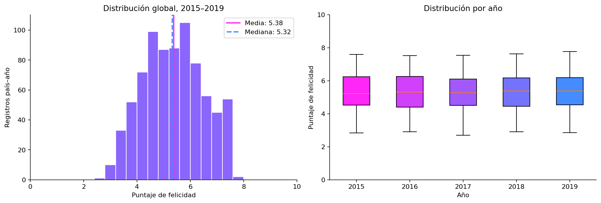

*Figura 1. Distribución de `happiness_score` en los 782 registros y comparación anual mediante diagramas de caja.*

Las medias anuales se encuentran aproximadamente entre **5,35 y 5,41**, y las medianas entre **5,23 y 5,38**. La dispersión entre países es mayor que el cambio del promedio anual. Las distribuciones conservan amplitudes semejantes; un promedio estable puede ocultar trayectorias nacionales diferentes. Los puntos fuera de los bigotes son señales exploratorias, no motivos suficientes para eliminar países.

### 5.2. Felicidad media y dispersión por región

Estas comparaciones emplean el **panel completo de 146 países y 730 registros**, manteniendo la misma composición en las cinco ediciones. Las etiquetas `n` indican países distintos, no personas.

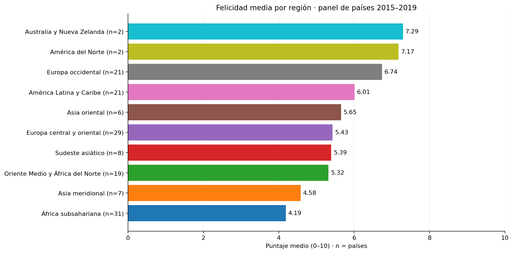

*Figura 2. Medias regionales del panel completo, ordenadas y representadas en escala de 0 a 10.*

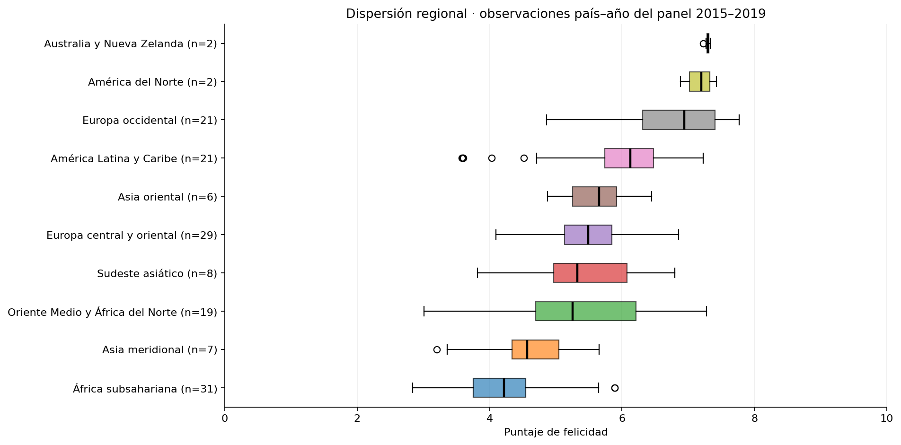

*Figura 3. Distribución de registros país–año dentro de cada región, utilizando el mismo panel.*

Australia y Nueva Zelanda, América del Norte y Europa Occidental presentan los mayores promedios; África Subsahariana y Asia Meridional, los menores. Las cajas muestran heterogeneidad y superposición entre regiones. América del Norte y Australia y Nueva Zelanda reúnen solamente dos países cada una, por lo que sus distribuciones requieren especial cautela. Una media regional alta no implica que todos sus países tengan puntajes elevados.

### 5.3. Evolución con composición constante

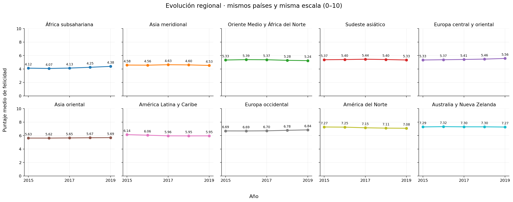

*Figura 4. Medias anuales por región con los mismos países y una escala común de 0 a 10.*

En el panel fijo, la media global pasa de **5,418 a 5,497**, un incremento de **0,079 puntos** entre 2015 y 2019. África Subsahariana presenta el mayor aumento regional (**+0,260**) y América del Norte el mayor descenso (**−0,188**). Son diferencias descriptivas, no pruebas de significación ni explicaciones causales. Gambia y los demás países de cobertura incompleta se conservan en el conjunto de datos general, pero se excluyen del panel temporal.

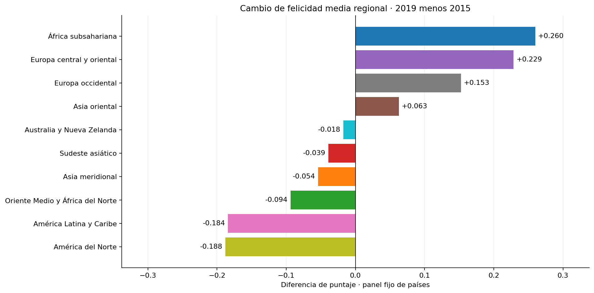

*Figura 5. Diferencia de puntaje medio: 2019 menos 2015. Se expresan puntos, no porcentajes.*

El cuaderno complementa esta lectura con [diagramas de caja regionales por año](dashboards/screenshots/eda/13_region_year_boxplots.png) y [diagramas de caja de países dentro de cada región](dashboards/screenshots/eda/14_countries_within_regions_boxplots.png). En estos últimos se seleccionan países de promedio bajo, central y alto de cada región; es una selección descriptiva explícita y no una muestra representativa.

### 5.4. Relación entre predictores y objetivo

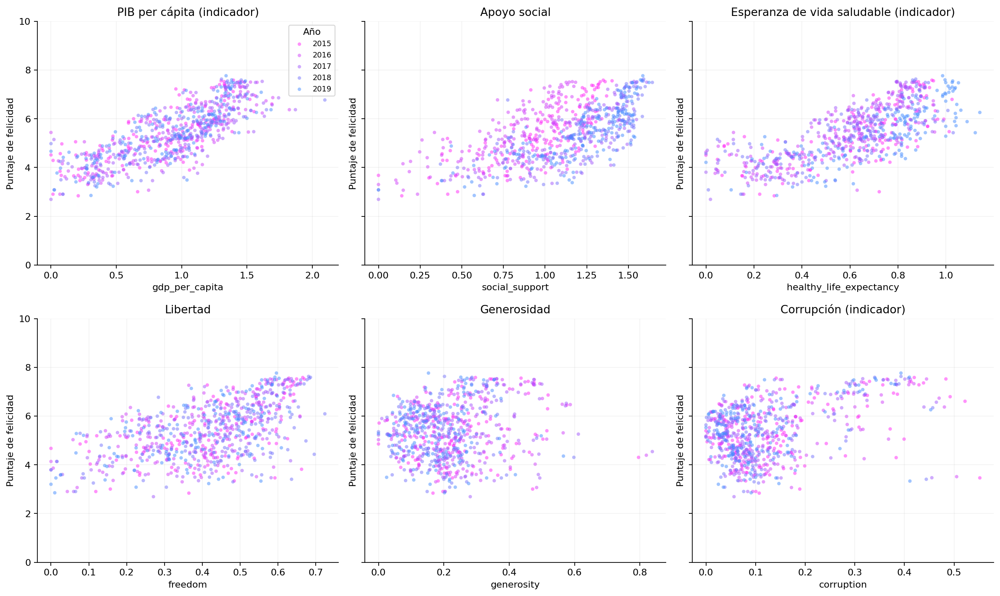

*Figura 6. Diagramas de dispersión coloreados por edición. Cada punto es un registro país–año.*

PIB per cápita, esperanza de vida saludable y apoyo social presentan asociaciones positivas con el objetivo. Generosidad muestra una relación lineal más débil. Las diferencias entre ediciones motivan la evaluación temporal y la revisión de posibles cambios de escala. Los diagramas describen dispersión y asociación; no constituyen una prueba formal de sobredispersión.

### 5.5. Correlación y multicolinealidad

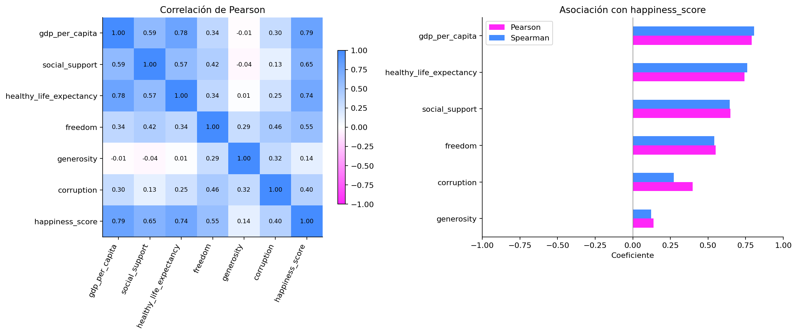

*Figura 7. Escala divergente fija de **−1 a +1**: azul representa asociación negativa, blanco proximidad a cero y rojo asociación positiva. El panel derecho compara Pearson y Spearman frente al objetivo.*

Las correlaciones de Pearson con `happiness_score` son aproximadamente **0,789** para PIB per cápita, **0,742** para esperanza de vida saludable y **0,649** para apoyo social. Para generosidad se obtiene **0,138**. Una correlación baja no basta para descartar una variable y una alta no garantiza capacidad predictiva fuera de muestra.

El par de predictores con mayor correlación lineal es PIB per cápita y esperanza de vida saludable (**0,784**). Los mayores factores de inflación de varianza son **2,933** y **2,751**, respectivamente; ninguno alcanza el umbral exploratorio de 5. Por este criterio no aparece una alerta elevada de multicolinealidad, sin descartar cualquier dependencia entre predictores. Este diagnóstico usa el conjunto exploratorio completo y no determina automáticamente la selección de variables del modelo.

## 6. Modelamiento: diseño experimental

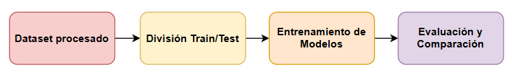

*Figura 8. Esquema general del proceso. La división se desarrolla mediante validación temporal expansiva y una prueba final reservada, según las tablas siguientes.*

### 6.1. Preparación de predictores

El [cuaderno de modelos](notebooks/models-happiness.ipynb) importa `happiness_modeling.csv`. La matriz de entrada contiene los seis indicadores numéricos y la respuesta corresponde a `happiness_score`.

`country` y `year` se conservan para trazabilidad y partición, pero no ingresan como predictores. No se incorpora `region`; tampoco `happiness_rank`, que deriva del objetivo. Por tanto, **no se requiere codificación de categorías**. La regresión lineal utiliza `StandardScaler` ajustado dentro del proceso de preprocesamiento y predicción de cada entrenamiento. Los árboles reciben los indicadores sin escalar. El procesamiento se aplica también al predecir y queda encapsulado en el archivo guardado.

### 6.2. Separación de desarrollo y prueba

La partición implementada es **cronológica**:

| Subconjunto | Ediciones | Registros | Proporción | Función |
| --- | --- | --- | --- | --- |
| Desarrollo | 2015–2018 | 626 | 80,05 % | Ajustar hiperparámetros, comparar candidatos mediante validación y entrenar los modelos evaluados en 2019. |
| Prueba final | 2019 | 156 | 19,95 % | Estimar desempeño temporal posterior a la selección. |

### 6.3. Validación temporal expansiva

Se usan tres ventanas dentro del desarrollo, sin entrenar con años posteriores al de validación:

| Ventana | Entrenamiento | Filas de entrenamiento | Validación | Filas de validación |
| --- | --- | --- | --- | --- |
| 1 | 2015 | 158 | 2016 | 157 |
| 2 | 2015–2016 | 315 | 2017 | 155 |
| 3 | 2015–2017 | 470 | 2018 | 156 |

## 7. Modelos seleccionados para la comparación

En las expresiones, $x$ representa los seis predictores, $\hat{y}$ la predicción y $T$ un árbol de regresión.

| Modelo | Expresión esquemática | Fundamento |
| --- | --- | --- |
| Regresión lineal | $\hat{y}=\beta_0+\sum_{j=1}^{6}\beta_j x_j$ | Ajusta una relación aditiva lineal minimizando errores cuadráticos. Alternativa sencilla e interpretable. |
| Bosque aleatorio (Random Forest) | $\hat{y}=\frac{1}{B}\sum_{b=1}^{B}T_b(x)$ | Promedia árboles entrenados con muestreo con reemplazo y aleatoriedad en su construcción. Representa relaciones no lineales e interacciones. |
| Árbol de decisión | $\hat{y}=\sum_{m=1}^{M}c_m\mathbf{1}(x\in R_m)$ | Divide el espacio de entrada en regiones con predicción constante. Requiere controlar su complejidad para limitar sobreajuste. |
| XGBoost | $F_t(x)=F_{t-1}(x)+\eta T_t(x)$ | Añade árboles secuencialmente para reducir una pérdida cuadrática con regularización; se usa `XGBRegressor`. |
| LightGBM | $F_t(x)=F_{t-1}(x)+\eta T_t(x)$ | Ensamble secuencial de árboles con histogramas y crecimiento por hojas; se usa `LGBMRegressor`. |

## 8. Evaluación de modelos

Se comparan RMSE y MAE (menor es mejor) y R² (mayor es mejor). La selección utiliza el **RMSE medio de validación temporal**; la prueba de 2019 se reserva para evaluar la decisión.

### 8.1. Rendimiento en validación

| Modelo | RMSE medio ↓ | DE del RMSE | MAE medio ↓ | R² medio ↑ |
| --- | --- | --- | --- | --- |
| Random Forest | 0,516 | 0,061 | 0,413 | 0,788 |
| XGBoost | 0,541 | 0,080 | 0,430 | 0,765 |
| LightGBM | 0,557 | 0,089 | 0,449 | 0,751 |
| Regresión lineal | 0,603 | 0,041 | 0,480 | 0,713 |
| Árbol de decisión | 0,618 | 0,072 | 0,483 | 0,696 |

Promedios de las tres ventanas temporales; DE es la desviación estándar entre ventanas, no un intervalo de confianza.

### 8.2. Rendimiento en entrenamiento y prueba

| Modelo | RMSE entrenamiento | RMSE validación | RMSE prueba |
| --- | --- | --- | --- |
| Random Forest | 0,219 | 0,516 | 0,619 |
| XGBoost | 0,327 | 0,541 | 0,668 |
| LightGBM | 0,310 | 0,557 | 0,581 |
| Regresión lineal | 0,548 | 0,603 | 0,550 |
| Árbol de decisión | 0,424 | 0,618 | 0,632 |

Entrenamiento: ajuste con 2015–2018. Validación: promedio de las ventanas 2016–2018. Prueba: 156 registros reservados de 2019. El menor error de entrenamiento no determina la selección.

| Modelo | RMSE ↓ | MAE ↓ | R² ↑ |
| --- | --- | --- | --- |
| Regresión lineal | 0,550 | 0,424 | 0,755 |
| LightGBM | 0,581 | 0,468 | 0,726 |
| Random Forest | 0,619 | 0,483 | 0,688 |
| Árbol de decisión | 0,632 | 0,507 | 0,675 |
| XGBoost | 0,668 | 0,527 | 0,637 |

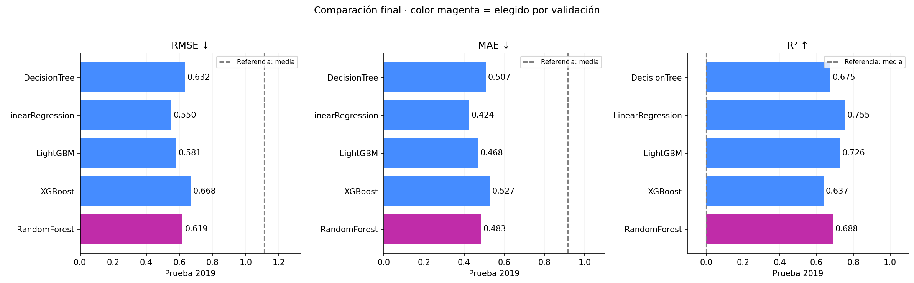

*Figura 9. Comparación en la prueba de 2019.*

La gráfica compara la prueba de 2019; el magenta identifica a Random Forest por su selección previa en validación. **Regresión lineal y LightGBM superan a Random Forest en las tres métricas de prueba.**

## 9. Modelo seleccionado y justificación

### 9.1. ¿Por qué se conserva Random Forest?

**Random Forest se selecciona por el menor RMSE medio de validación temporal (0,516)**, antes de consultar 2019. La regresión lineal obtiene el mejor RMSE de prueba (0,550), frente a 0,619 de Random Forest. Se conserva la selección previa para mantener la prueba como evaluación independiente del proceso de elección.

La elección no se fundamenta en el error de entrenamiento ni en un equilibrio entre entrenamiento y prueba. La brecha de Random Forest entre ambos conjuntos limita su generalización; el resultado de 2019 favorece a la regresión lineal. Cambiar de modelo usando esa prueba requeriría reservar otra evaluación independiente. No se demuestra superioridad universal de Random Forest.

### 9.2. Valores observados y predichos

La tabla presenta ejemplos de distintas regiones e incluye Botswana, el caso de mayor error absoluto. Es una ilustración identificada por país, no una muestra aleatoria ni una evaluación adicional. **Residuo = observado − predicho**: valores positivos indican subestimación y negativos, sobreestimación.

| País | Observado | Predicho | Residuo | Error absoluto |
| --- | --- | --- | --- | --- |
| Argentina | 6,086 | 6,124 | -0,038 | 0,038 |
| Colombia | 6,125 | 6,066 | 0,059 | 0,059 |
| Estados Unidos | 6,892 | 6,615 | 0,277 | 0,277 |
| Finlandia | 7,769 | 6,438 | 1,331 | 1,331 |
| Japón | 5,886 | 5,951 | -0,065 | 0,065 |
| Gambia | 4,516 | 4,251 | 0,265 | 0,265 |
| Botswana | 3,488 | 5,733 | -2,245 | 2,245 |
| Dinamarca | 7,600 | 6,461 | 1,139 | 1,139 |

Las 156 predicciones del seleccionado y sus errores se conservan en [best_model_errors_2019.csv](data/reports/models/best_model_errors_2019.csv). Las predicciones de los cinco modelos están en [test_predictions_2019.csv](data/reports/models/test_predictions_2019.csv).

## 10. Persistencia y uso del modelo

Tras completar la evaluación, se conserva la configuración de Random Forest —**250 árboles, profundidad máxima sin límite y mínimo de dos observaciones por hoja**— y se reentrena con los **782 registros de 2015–2019** para producir el artefacto final.

El modelo y su preprocesamiento se guardan en [models/model.pkl](models/model.pkl). La preparación y el estimador quedan encapsulados; los predictores se seleccionan por nombre. [model_metadata.json](models/model_metadata.json) registra columnas, semilla, particiones, parámetros, métricas, versiones y huella SHA-256 del conjunto de datos.

**Las métricas de 2019 corresponden al ajuste 2015–2018, no al reentrenamiento con 2015–2019. El archivo final no dispone de un conjunto independiente adicional para evaluar ese último ajuste.** Verificar su carga y predicciones comprueba persistencia, no generalización.

## 11. Parte B — ETL de eventos con Apache Kafka

Esta etapa transforma el histórico preparado en un flujo simulado y ejecuta inferencia al recibir cada evento. La implementación se concentra en [producer.py](kafka/producer.py) y [consumer.py](kafka/consumer.py); Kafka transporta los mensajes y PostgreSQL conserva el original y el resultado.

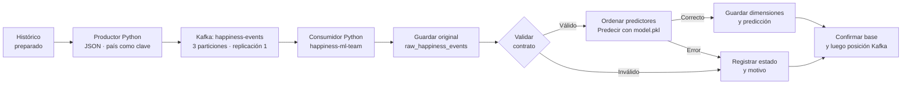


Si falla la escritura en PostgreSQL, no se confirma la posición en Kafka. El original ya guardado permite reintentar el procesamiento sin duplicar la predicción.

### 11.1. Paso 5 — Productor de Kafka

| Requisito del ejercicio | Implementación realizada | Evidencia en el código |
| --- | --- | --- |
| Leer el histórico registro por registro. | Se recorre `happiness_modeling.csv` con `csv.DictReader`, sin cargar el archivo completo en memoria. | `iter_events()` en `producer.py`. |
| Publicar eventos individualmente. | Cada fila produce un evento; se espera la confirmación antes de continuar. | `produce()` y `flush()` dentro del ciclo. |
| Serializar como JSON. | Se construyen los campos del contrato, se serializan mediante `json.dumps` y se codifican en UTF-8. | `allow_nan=False` impide publicar NaN o Infinity. |
| Usar el país como clave Kafka. | `country` se envía como clave UTF-8 para mantener los eventos del mismo país en la misma partición. | `key=event["country"].encode("utf-8")`. |
| Simular llegada de eventos en el tiempo. | Se introduce una pausa entre publicaciones, configurable en segundos. | `--delay` y `time.sleep(delay)`; valor inicial de 0,1 segundos. |
| Tópico obligatorio `happiness-events`. | Se utiliza el mismo nombre en productor, consumidor y configuración del broker. | Constante `TOPIC` y `docker-compose.yml`. |
| Tres particiones y replicación uno. | Se crea el tópico con esta topología y se comprueba que un tópico existente la respete. | `NewTopic(..., num_partitions=3, replication_factor=1)`. |
| Identificación y momento de emisión. | Se genera un identificador único por ejecución y secuencia, junto con la hora UTC de emisión. | `event_id` y `event_time` en cada registro. |

Kafka garantiza el orden dentro de una partición; no se establece un orden global entre las tres particiones. Una nueva ejecución del productor representa otra simulación y genera identificadores nuevos.

### 11.2. Contrato de eventos — Campos y correspondencia con el modelo

| Campo del evento | Tipo y validación | Uso posterior |
| --- | --- | --- |
| `event_id` | Cadena de texto no vacía, con Unicode válido y sin carácter nulo. Se comprueba que no haya sido aceptado previamente. | Trazabilidad y control de duplicados. |
| `country` | Cadena de texto no vacía; debe coincidir exactamente con la clave Kafka en UTF-8. | Resolver `dim_country`; no ingresa al modelo. |
| `year` | Entero de la observación histórica, entre 2015 y 2019. No se aceptan booleanos ni números escritos como texto. | `observation_year`; no ingresa al modelo. |
| `gdp` | Número finito, no negativo y compatible con el modelo. | Predictor 1: `gdp_per_capita`. |
| `family` | Misma validación numérica. | Predictor 2: `social_support`. |
| `health` | Misma validación numérica. | Predictor 3: `healthy_life_expectancy`. |
| `freedom` | Misma validación numérica. | Predictor 4: `freedom`. |
| `generosity` | Misma validación numérica. | Predictor 5: `generosity`. |
| `corruption` | Misma validación numérica. | Predictor 6: `corruption`. |
| `actual_happiness_score` | Número finito entre 0 y 10. | Se almacena como valor real para calcular el error; **se excluye de la matriz de entrada**. |
| `event_time` | Fecha y hora ISO-8601 válida; el productor emite UTC. | Fecha de emisión y análisis temporal del flujo. |

Los campos son obligatorios. El consumidor rechaza valores numéricos ausentes, null, booleanos, texto numérico, NaN, Infinity o magnitudes incompatibles con float32. Los indicadores no se limitan a [0,1], porque el histórico contiene valores superiores a uno. La validación de negocio corresponde a la aplicación, no al broker Kafka.

### 11.3. Paso 6 — Consumidor de Kafka

| Requisito del ejercicio | Implementación realizada | Resultado verificable |
| --- | --- | --- |
| Usar `happiness-ml-team`. | El consumidor se suscribe a `happiness-events` con ese grupo. | Posiciones y retraso de consumo identificables por grupo y partición. |
| Recibir eventos continuamente. | Se consulta Kafka mediante `poll()` hasta detener el proceso. | Una ejecución de procesamiento por mensaje recibido. |
| Guardar el original antes de transformar o predecir. | Se insertan valor y clave originales como `BYTEA` y se confirma la transacción antes de interpretar JSON. | Fila de almacenamiento original persistente, incluso si después falla el contrato o la inferencia. |
| Validar el contrato y las características necesarias. | Se comprueban JSON, campos obligatorios, tipos, rangos, finitud, marca de tiempo y correspondencia de la clave. | Estado y motivo identifican el rechazo; se nombran los campos faltantes. |
| Aplicar el mismo orden y preprocesamiento. | Se construyen exactamente las seis columnas y se verifica su orden contra `feature_names_in_`. | Se invoca el proceso de preprocesamiento y predicción guardado; no se ajusta un nuevo preprocesador. |
| Cargar el modelo y predecir. | Se carga `models/model.pkl` una vez al iniciar y se llama a `predict()` para cada evento válido. | Puntaje predicho finito asociado a la versión del artefacto. |
| Almacenar predicciones y errores. | Se cargan dimensiones y `fact_predictions`, relacionadas con el original mediante `raw_event_id`. | Resultado reconstruible desde el mensaje que lo originó. |
| Conservar inválidos y continuar. | Los rechazos se registran sin llamar al modelo; los fallos de inferencia también se auditan. | El siguiente mensaje puede procesarse normalmente. |
| Confirmar después de persistir. | El confirmación de la posición en Kafka ocurre después del confirmación en PostgreSQL. | Una reentrega no genera otro hecho para el mismo original. |

| Estado del evento original | Interpretación | ¿Genera fila en `fact_predictions`? |
| --- | --- | --- |
| `RECEIVED` | Original guardado; procesamiento pendiente. | No todavía. |
| `VALID` | Contrato aceptado, predicción y carga terminadas. | Sí, una. |
| `INVALID_SCHEMA` | JSON, estructura, campos o tipos incorrectos. | No. |
| `INVALID_VALUES` | Valores, fecha o clave inválidos, o identificador duplicado. | No. |
| `PREDICTION_ERROR` | Evento aceptado por el contrato, pero la inferencia falla. | No. |

Un error propio del registro no interrumpe el flujo. Si PostgreSQL no puede guardar una transacción, el consumidor se detiene sin confirmar esa posición para evitar la pérdida silenciosa del mensaje. La [guía operativa](kafka/README.md) complementa esta síntesis.

## 12. Parte C — Almacén de datos y análisis de predicciones

El almacén en PostgreSQL organiza los resultados mediante una tabla de almacenamiento original y un modelo estrella. El diseño y las vistas se implementan en [sql/streaming.sql](sql/streaming.sql); el consumidor realiza la carga sin distribuir la lógica entre módulos adicionales.

### 12.1. Cinco requerimientos analíticos y KPI

| ID | Pregunta que debe responder el análisis | Desagregación y criterio | KPI y fuente |
| --- | --- | --- | --- |
| R1 | ¿Cuántos mensajes se recibieron, cuántos terminaron con predicción y por qué se rechazaron los demás? | Por día UTC de recepción y estado final; distinguir pendientes, rechazos del contrato y errores de inferencia. | Conteos, porcentaje con predicción y porcentaje de rechazo: `v_event_quality_daily`. |
| R2 | ¿Cuánto difiere el puntaje predicho del real para cada país y región en cada edición histórica? | Comparar la misma población de eventos, año histórico y versión del modelo. | Media real, media predicha y error medio con signo: `v_prediction_metrics`. |
| R3 | ¿Qué precisión presenta el modelo en cada edición y agrupación geográfica? | Calcular desde errores individuales para país–año, región–año y total anual; separar versiones. | MAE, RMSE y R²: `v_prediction_metrics`. R² queda nulo si no hay al menos dos valores reales con variación. |
| R4 | ¿Cuántas predicciones se generan por día y cuánto transcurre desde emitir un evento hasta predecirlo? | Agrupar por día UTC de emisión y versión; incluir la espera en Kafka en la demora total. | Predicciones diarias y demora media en milisegundos: `v_prediction_activity_daily`. |
| R5 | ¿Qué países presentan los errores más elevados y qué proporción supera medio punto? | Ordenar países por MAE dentro del mismo año histórico y versión; conservar empates en la clasificación. | Clasificación, máximo error absoluto y porcentaje con error absoluto **> 0,5**: `v_country_error_ranking`. |

### Granularidad

**Cada fila en `fact_predictions` corresponde a una predicción generada para un evento válido de un país y año histórico, con la versión del modelo utilizada.**


### 12.2. Modelo dimensional

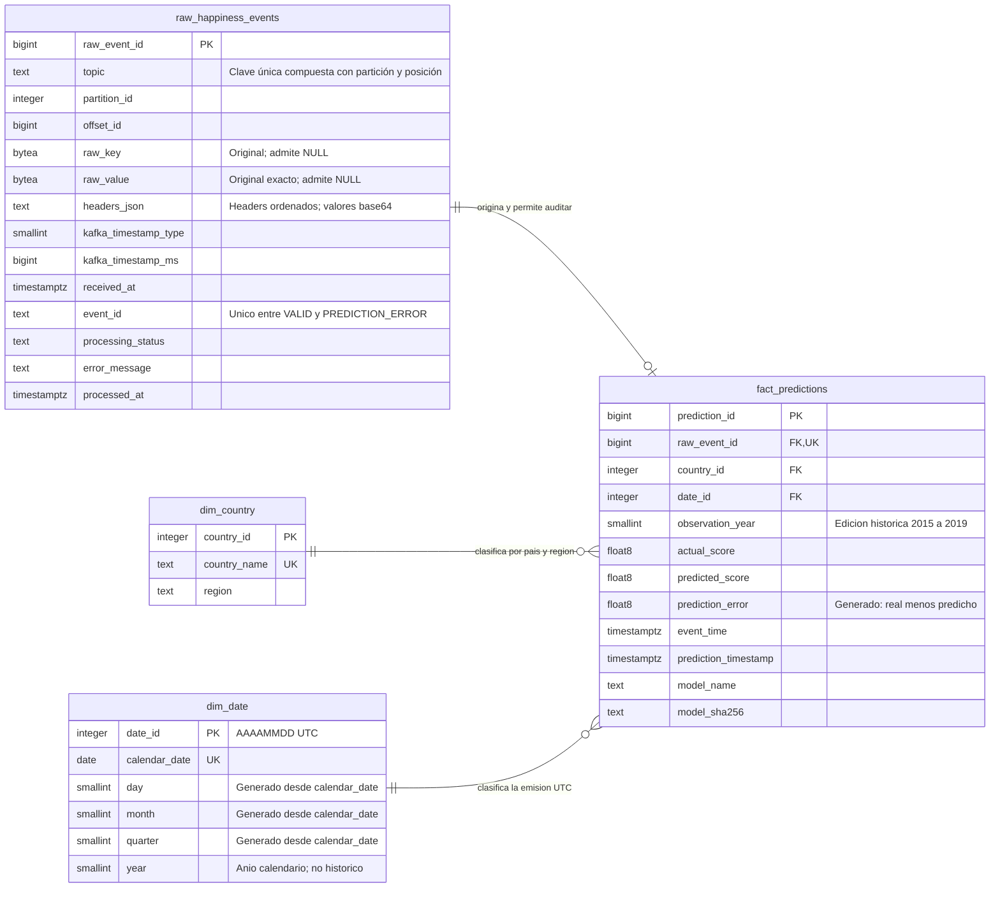

### 12.3. Carga de eventos originales y resultados de predicción

El consumidor debe completar las siguientes operaciones en este orden. La tabla raw conserva todos los mensajes; solo los válidos que producen una predicción ingresan al hecho.

| Paso | Operación de carga | Destino y regla | Condición de finalización |
| --- | --- | --- | --- |
| 1 | Guardar bytes originales, clave, tópico, partición, posición y metadatos de recepción. | Insertar en `raw_happiness_events` con estado `RECEIVED`; la posición Kafka es única. | **Confirmar esta transacción antes de deserializar JSON.** |
| 2 | Interpretar el evento y validar el contrato. | Si falla, conservar el original, registrar estado y motivo, y omitir inferencia y carga del hecho. | Rechazo persistente; continuar con el siguiente mensaje después de confirmar la posición. |
| 3 | Controlar reentregas e identificadores repetidos. | Si la posición ya tiene estado final, no repetirla. Si otro mensaje aceptado utilizó `event_id`, marcar `INVALID_VALUES`. | Como máximo un hecho por original. |
| 4 | Preparar las seis entradas y ejecutar `model.pkl`. | Respetar el orden entrenado y excluir el puntaje real. Si falla, registrar `PREDICTION_ERROR`. | Predicción numérica finita o error de inferencia persistido. |
| 5 | Resolver `country_id`. | Buscar el país normalizado en `dim_country`. El catálogo inicial contiene 165 países y sus regiones; un país nuevo válido se incorpora con región `Desconocido`. | Clave de país válida, sin inventar una región. |
| 6 | Resolver `date_id` a partir de la emisión. | Convertir `event_time` a UTC e insertar el día en `dim_date` si no existe. Conservar `year` como `observation_year`. | Fecha de emisión y año histórico claramente separados. |
| 7 | Insertar la predicción y su trazabilidad. | Guardar referencias al evento original, país y fecha, año histórico, puntaje real, predicho, `event_time`, `prediction_timestamp` y versión del modelo. PostgreSQL almacena `prediction_error = actual_score − predicted_score`. | Una fila completa en `fact_predictions`, vinculada al original. |
| 8 | Finalizar la carga y confirmar Kafka. | Dimensiones, hecho y estado `VALID` se confirman juntos. Después se confirma la posición en Kafka. | Un fallo de carga revierte esa transacción; el original permanece `RECEIVED` para reintento. |

El instante histórico y el operativo tienen funciones distintas: un registro de **2019** puede emitirse en **2026**. No se inventa un día o mes para la edición histórica. `TIMESTAMPTZ` conserva los instantes y `dim_date` agrupa el día de emisión UTC; una hora entrante sin zona se interpreta como UTC según la convención del ejercicio. Un disparador de base de datos impide modificar los campos originales del staging.

La carga inicial fue contrastada con Kafka y con el modelo guardado; la evidencia está en [verification.json](data/reports/streaming/verification.json). Sus conteos describen esa ejecución y no son valores fijos del sistema: nuevas simulaciones agregan eventos.

## 13. Panel de control e indicadores clave

El panel de Power BI presenta cinco requerimientos: calidad del flujo, comparación real–predicho, precisión, actividad temporal y países con mayores errores. Las capturas muestran los resultados con los filtros seleccionados; los conteos pueden cambiar al repetir la simulación.

### 13.1. R1 — Calidad del flujo

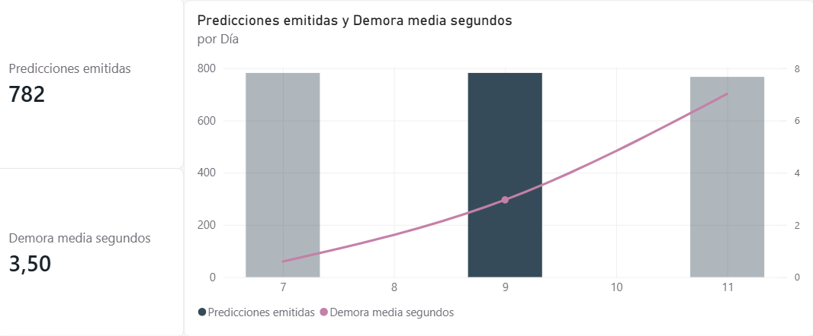

La captura muestra recibidos y predichos con visualización abreviada («2 mil»), y cero rechazos. No presenta tarjetas de pendientes ni porcentajes de predicción y rechazo; el gráfico de rechazos y fallos no muestra barras. Estos elementos deben distinguirse de los indicadores definidos en R1, aunque en esta ejecución no se observen rechazos.

### 13.2. R2 — Comparación real–predicho

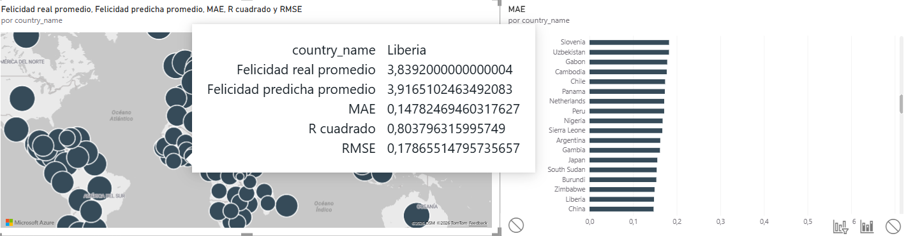

El mapa permite consultar la media real y predicha por país. La captura muestra a Liberia y sus métricas de error; el gráfico lateral compara el MAE entre países.

### 13.3. R3 — Precisión del modelo

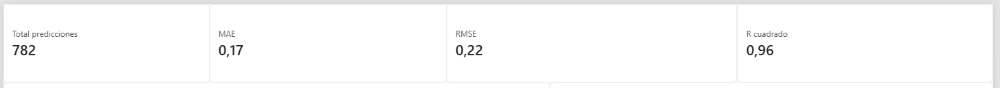

La captura registra 782 predicciones, MAE de 0,17, RMSE de 0,22 y R² de 0,96. Son métricas del histórico reutilizado en la simulación con el modelo final reentrenado; no sustituyen los resultados de prueba de la Parte A.

### 13.4. R4 — Actividad y demora del flujo de eventos

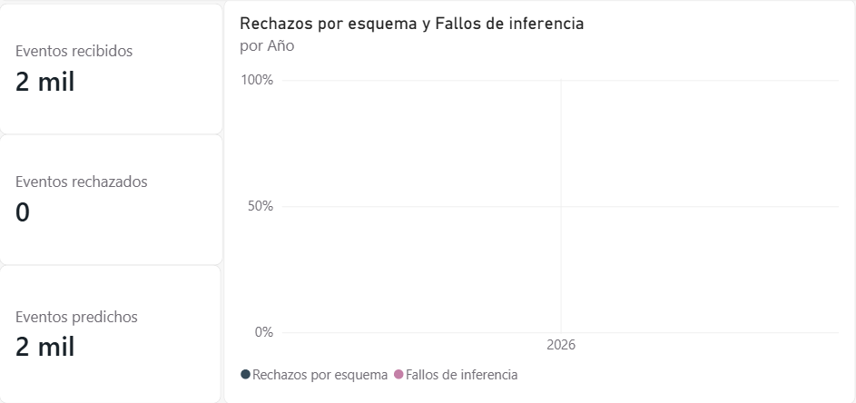

Las columnas representan predicciones y la línea, demora media en segundos, con un eje independiente. En la selección visible, las tarjetas muestran 782 predicciones y 3,50 segundos. La demora incluye espera en Kafka y procesamiento. Para identificar inequívocamente cada jornada se debe usar la fecha completa de emisión en UTC, en lugar del número de día aislado.

### 13.5. R5 — Países con mayores errores

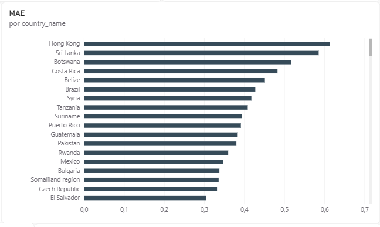

La clasificación ordena los países por MAE descendente. Hong Kong presenta el mayor valor entre los países visibles, seguido de Sri Lanka y Botswana. Esta captura documenta la clasificación por MAE; el máximo error absoluto y el porcentaje de errores superiores a 0,5 puntos no se muestran.

### 13.6. Criterios de interpretación de los KPI

| Indicador o consulta | Regla de cálculo e interpretación |
| --- | --- |
| Porcentaje con predicción | `100 × válidos / recibidos`; incluye los pendientes en el denominador. |
| Porcentaje de rechazo | `100 × (INVALID_SCHEMA + INVALID_VALUES) / finalizados`; excluye `RECEIVED` y muestra `PREDICTION_ERROR` por separado. |
| Error con signo | `actual_score − predicted_score`: positivo indica subestimación y negativo, sobreestimación. |
| MAE y RMSE | Se calculan desde los errores individuales. No se promedian RMSE de países para obtener un RMSE regional. |
| R² | Requiere al menos dos observaciones y variación del valor real. No equivale a porcentaje de predicciones correctas ni se promedia entre subgrupos. |
| Nivel geográfico de la vista | En `v_prediction_metrics`, país informado = país; país nulo y región informada = región; ambos nulos = total anual. Filtrar un solo nivel para evitar doble conteo. |
| Edición histórica frente a fecha del flujo | `observation_year` se utiliza para el histórico; `calendar_date` identifica el día UTC de emisión y `received_date`, el día UTC de recepción. |
| Repetición de simulaciones | Los KPI operativos cuentan eventos. Para describir el histórico, seleccionar una observación por país–año y versión dentro de la ventana elegida, evitando sobreponderar países republicados. |
| Demora emisión–predicción | Incluye permanencia en Kafka y procesamiento. Los mensajes recuperados después de varias horas no representan exclusivamente tiempo de cómputo del modelo. |
| Alcance predictivo | El flujo reutiliza datos incluidos en el reentrenamiento; estas métricas no sustituyen la evaluación temporal independiente de la Parte A. |

## 14. Limitaciones y alcance

- **Datos agregados y comparabilidad.** Se utilizan 782 registros país–edición, no respuestas individuales de encuestas. La cobertura cambia entre años y los indicadores publicados pueden diferir en construcción o escala; los resultados no se extrapolan a personas ni a países nuevos.
- **Preparación de los datos.** La imputación de corrupción utiliza la mediana de 2018 completo, previa a la partición, lo que limita la independencia de esa validación. El redondeo a tres decimales reduce precisión y la recuperación regional supone una clasificación estable. Los originales se conservan para revisar estas decisiones.
- **Evaluación temporal acotada.** Solo existen tres ventanas de validación y una edición de prueba. Los países se repiten entre conjuntos: se evalúa una edición posterior, no la generalización a países completamente nuevos. La búsqueda de parámetros es limitada y no se demuestran diferencias estadísticamente significativas.
- **Selección y modelo final.** Random Forest gana en validación, pero la regresión lineal obtiene mejores resultados en 2019. El archivo final se reentrena con 2015–2019; las métricas del panel reutilizan ese histórico y pueden ser optimistas. Se necesitan datos posteriores e independientes para evaluar el artefacto final.
- **Alcance de las predicciones.** El modelo estima felicidad a partir de indicadores disponibles para la observación; no pronostica sus valores futuros. Las asociaciones y las importancias de variables no demuestran causalidad.
- **Entorno de ejecución local.** Un único servidor Kafka con replicación uno no proporciona tolerancia a la pérdida del servidor. La demora depende de la pausa del productor, la espera acumulada y el equipo; no constituye una prueba de rendimiento en producción.
- **Lectura del panel.** Cada nueva publicación genera eventos nuevos, por lo que repetir el histórico incrementa los conteos. En modo Importar, Power BI requiere actualización para incorporar cambios. Las capturas son evidencia puntual: la de R1 aún no muestra todos los indicadores exigidos y R5 muestra el orden por MAE, pero no el máximo error ni el porcentaje superior a 0,5 puntos.

## 15. Estructura del proyecto

```text
workshop-3/
├── README.md                         # Metodología, resultados y ejecución
├── docker-compose.yml                # Kafka; PostgreSQL Docker opcional
├── requirements.txt                  # Dependencias Python
├── .env                              # Configuración local; excluida de Git
├── data/
│   ├── raw/                          # CSV originales 2015–2019
│   ├── processed/                    # Datasets preparados y metadatos
│   └── reports/
│       ├── profile_2015.html …        # Informes de calidad por edición
│       ├── eda/                      # Tablas del análisis exploratorio
│       ├── models/                   # Búsquedas, métricas y predicciones 2019
│       └── streaming/verification.json
├── notebooks/
│   ├── data-profiling.ipynb
│   ├── transform-data.ipynb
│   ├── exploratory-data-analysis.ipynb
│   └── models-happiness.ipynb
├── models/
│   ├── model.pkl                     # Pipeline final reentrenado
│   └── model_metadata.json            # Esquema, versión y trazabilidad
├── kafka/
│   ├── producer.py                   # Lectura, contrato de salida y publicación
│   ├── consumer.py                   # Validación, inferencia y carga PostgreSQL
│   └── README.md                     # Guía operativa complementaria
├── gx/
│   └── happiness_validation.py        # Tres reglas de calidad del proyecto
├── sql/
│   └── streaming.sql                 # Staging, dimensiones, hecho y vistas
├── dashboards/
│   ├── diagrams/                     # Arquitectura y flujo de entrenamiento
│   └── screenshots/                  # Figuras EDA/modelos y capturas Power BI
└── tests/
    └── test_streaming.py              # Contrato, persistencia y KPI PostgreSQL
```

## 16. Instrucciones de ejecución

Ejecutar desde la raíz del proyecto en **Git Bash (Windows)**. Tener instalados Python, Docker Desktop y PostgreSQL; iniciar Docker Desktop y el servicio PostgreSQL local.

### 16.1. Instalar dependencias

```bash
python -m venv .venv
./.venv/Scripts/python.exe -m pip install -r requirements.txt
```

### 16.2. Configurar el entorno

Crear o completar `.env` en la raíz con estos valores y sustituir la contraseña:

```dotenv
PGHOST=''
PGPORT=''
PGUSER=''
PGPASSWORD='TU_CONTRASEÑA'
PGDATABASE=happiness_dw
PGCONNECT_TIMEOUT=5
KAFKA_BOOTSTRAP_SERVERS=127.0.0.1:9092
KAFKA_EXTERNAL_HOST=127.0.0.1
KAFKA_PORT=9092
KAFKA_TOPIC=happiness-events
KAFKA_CONSUMER_GROUP=happiness-ml-team
PRODUCER_DELAY_SECONDS=0.1
```


### 16.3. Ejecutar los cuadernos

En VS Code, seleccionar `.venv` como kernel y ejecutar las celdas en este orden:

1. `notebooks/data-profiling.ipynb`
2. `notebooks/transform-data.ipynb`
3. `notebooks/exploratory-data-analysis.ipynb`
4. `notebooks/models-happiness.ipynb`

Si ya están disponibles los CSV preparados y `models/model.pkl`, continuar con el siguiente paso.

### 16.4. Crear la base de datos

```bash
./.venv/Scripts/python.exe kafka/consumer.py --init-db
```

En pgAdmin, actualizar **Databases → happiness_dw → Schemas → public → Tables**.

### 16.5. Iniciar Kafka

```bash
docker compose up -d
docker compose ps -a
docker compose logs kafka-init
```

Comprobar que Kafka esté `healthy` y que `happiness-events` tenga **3 particiones y replicación 1**. No activar el perfil Docker `database`: se utiliza PostgreSQL local.

### 16.6. Ejecutar el flujo de eventos

**Terminal 1 — consumidor**, desde la raíz:

```bash
./.venv/Scripts/python.exe kafka/consumer.py
```

**Terminal 2 — productor**, desde la raíz:

```bash
./.venv/Scripts/python.exe kafka/producer.py --delay 0.1
```

Esperar a que el productor termine de publicar el histórico.

### 16.7. Comprobar la carga

En pgAdmin, abrir **Query Tool** sobre `happiness_dw` y ejecutar:

```sql
SELECT processing_status, COUNT(*)
FROM raw_happiness_events
GROUP BY processing_status;

SELECT COUNT(*) AS total_predictions FROM fact_predictions;

SELECT * FROM v_event_quality_daily ORDER BY received_date;
SELECT * FROM v_prediction_activity_daily ORDER BY calendar_date;
```

### 16.8. Conectar Power BI

1. Seleccionar **Obtener datos → PostgreSQL**.
2. Indicar servidor `localhost:5432`, base `happiness_dw` y modo **Importar**.
3. Autenticarse con `postgres` y la contraseña local.
4. Cargar `fact_predictions`, `dim_country`, `dim_date` y `raw_happiness_events`.
5. Cargar `v_event_quality_daily` y `v_prediction_activity_daily` para R1 y R4.
6. Configurar las relaciones según el diagrama dimensional; mantener las dos vistas diarias sin relaciones automáticas.
7. Pulsar **Actualizar** después de procesar nuevos eventos.

### 16.9. Validar calidad con Great Expectations

Ejecutar las tres validaciones descritas en la [sección 4.2](#42-validaciones-de-calidad-con-great-expectations), después de completar la carga:

```bash
./.venv/Scripts/python.exe gx/happiness_validation.py
```

### 16.10. Ejecutar pruebas de PostgreSQL

```bash
RUN_POSTGRES_TESTS=1 ./.venv/Scripts/python.exe -m unittest discover -s tests -v
```

### 16.11. Detener el flujo

En la terminal del consumidor, pulsar `Ctrl+C`. Después ejecutar:

```bash
docker compose down
```

## 17. Fuentes y documentación técnica

- [World Happiness Report: metodología](https://www.worldhappiness.report/faq/).
- [World Happiness Report en Kaggle: archivos históricos](https://www.kaggle.com/datasets/unsdsn/world-happiness).
- [Naciones Unidas: clasificación geográfica M49](https://unstats.un.org/unsd/methodology/m49/overview).
- [scikit-learn: métricas de evaluación](https://scikit-learn.org/stable/modules/model_evaluation.html).
- [XGBoost: API de Python](https://xgboost.readthedocs.io/en/stable/python/python_api.html).
- [LightGBM: LGBMRegressor](https://lightgbm.readthedocs.io/en/stable/pythonapi/lightgbm.LGBMRegressor.html).
- [Apache Kafka: imagen oficial y configuración Docker](https://hub.docker.com/r/apache/kafka).
- [Confluent: cliente Python para Kafka y posiciones de consumo](https://docs.confluent.io/kafka-clients/python/current/index.html).
- [PostgreSQL: almacenamiento binario del original](https://www.postgresql.org/docs/current/datatype-binary.html).
- [PostgreSQL: fechas, horas y zonas horarias](https://www.postgresql.org/docs/current/datatype-datetime.html).
- [Psycopg: transacciones con PostgreSQL](https://www.psycopg.org/psycopg3/docs/basic/transactions.html).
- [Great Expectations: ejecución de una expectativa](https://docs.greatexpectations.io/docs/core/define_expectations/test_an_expectation/).
