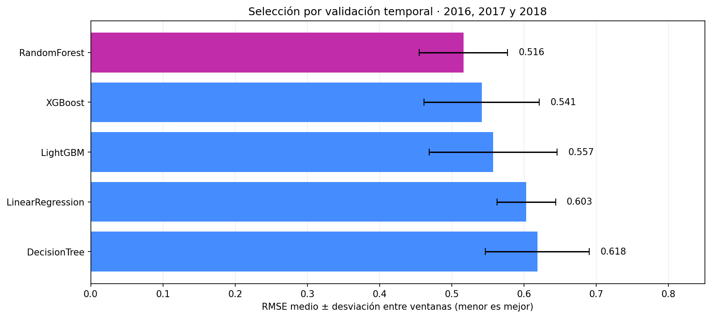
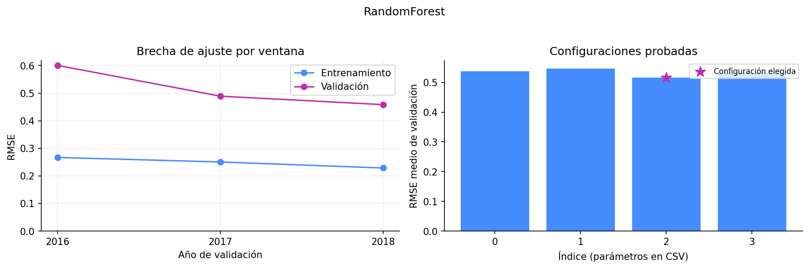
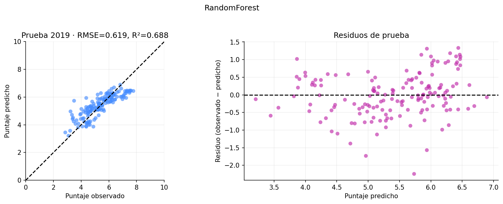
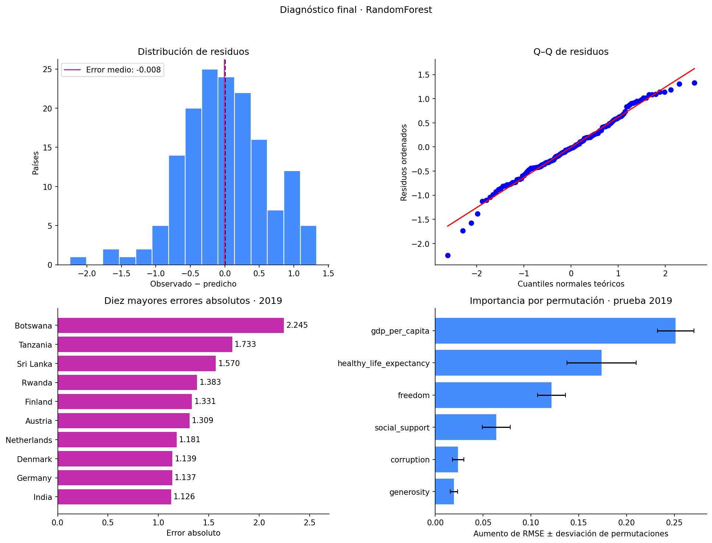

# Predicción del puntaje de felicidad mediante modelos de regresión

## 1. Introducción

Este proyecto desarrolla un proceso reproducible de perfilado, transformación, análisis exploratorio y modelamiento supervisado de los datos del **World Happiness Report, ediciones de 2015 a 2019**. Su objetivo es estimar `happiness_score` a partir de seis indicadores comunes a los archivos históricos y comparar la capacidad de generalización temporal de cinco modelos de regresión.

El puntaje representa evaluaciones de vida en una escala de 0 a 10, obtenidas mediante la escala de Cantril en la Gallup World Poll. Los seis factores empleados para explicar diferencias entre países —PIB per cápita, apoyo social, esperanza de vida saludable, libertad, generosidad y percepción de corrupción— **no constituyen una fórmula de cálculo del ranking**. Véase la [metodología del World Happiness Report](https://www.worldhappiness.report/faq/).

La unidad analítica es el **registro país–edición**, identificado por `country` y `year`. En los notebooks se denomina país–año; `year` identifica el archivo o edición y no garantiza que todas las mediciones originales se hayan recogido exclusivamente en ese año. Se conserva la denominación operativa «país» para las unidades geográficas del dataset, que también incluye territorios.

El alcance actual comprende preparación, análisis, entrenamiento por lotes y simulación de Streaming ETL con Apache Kafka e inferencia en Python. La arquitectura final permanece reservada para su documentación por el autor; la implementación local de la Parte B se describe en la sección 14.

## 2. Arquitectura del sistema


## 3. Conjunto de datos

Los archivos proceden de la recopilación [World Happiness Report en Kaggle, publicada por SDSN](https://www.kaggle.com/datasets/unsdsn/world-happiness), basada en los informes del World Happiness Report. Los originales se conservan en `data/raw/` y se consultan sin sobrescribirlos.

| Edición | Archivo original | Registros | Variables originales |
| --- | --- | --- | --- |
| 2015 | `data/raw/2015.csv` | 158 | 12 |
| 2016 | `data/raw/2016.csv` | 157 | 13 |
| 2017 | `data/raw/2017.csv` | 155 | 12 |
| 2018 | `data/raw/2018.csv` | 156 | 9 |
| 2019 | `data/raw/2019.csv` | 156 | 9 |

Se dispone de **782 registros**. Tras normalizar nombres se identifican **165 países o territorios distintos** y un panel completo de **146 unidades con observaciones en las cinco ediciones**. Las cantidades de variables de la tabla corresponden a los CSV originales, antes de incorporar `year` y homogeneizar esquemas.

### 3.1. Variables de trabajo

| Variable canónica | Función | Interpretación operativa |
| --- | --- | --- |
| `country` | Identificador | Nombre normalizado del país o territorio. |
| `year` | Identificador temporal | Año de la edición; define las ventanas de desarrollo y prueba. |
| `region` | Agrupación descriptiva | Región normalizada o completada; se utiliza en el análisis exploratorio. |
| `happiness_rank` | Variable descriptiva | Posición en la clasificación; se excluye como predictor porque deriva del puntaje. |
| `happiness_score` | Objetivo | Puntaje de evaluación de vida que se desea estimar. |
| `gdp_per_capita` | Predictor numérico | Indicador asociado al PIB per cápita. |
| `social_support` | Predictor numérico | Indicador asociado a la disponibilidad percibida de apoyo social. |
| `healthy_life_expectancy` | Predictor numérico | Indicador asociado a la esperanza de vida saludable. |
| `freedom` | Predictor numérico | Indicador asociado a la libertad para tomar decisiones de vida. |
| `generosity` | Predictor numérico | Indicador asociado a la generosidad. |
| `corruption` | Predictor numérico | Indicador asociado a percepción de corrupción y confianza institucional. |

Los campos numéricos se interpretan como **indicadores publicados en los archivos**. Pueden representar contribuciones estimadas por el informe; no deben leerse automáticamente como dólares, años de vida o proporciones de población. La homogeneización de nombres no demuestra equivalencia metodológica completa entre ediciones. Una asociación positiva de `corruption` con el objetivo no significa que una mayor corrupción produzca mayor felicidad.

## 4. Perfilado de datos y decisiones de transformación

El [notebook de perfilado](notebooks/data-profiling.ipynb) examina estructura, tipos, nulos, duplicados, categorías y valores potencialmente atípicos. Los informes HTML por edición, generados mediante YData Profiling, se conservan en `data/reports/profile_2015.html` a `profile_2019.html`.

| Dimensión de calidad | Hallazgo verificado | Decisión aplicada |
| --- | --- | --- |
| Valores ausentes en campos publicados | Un nulo en `Perceptions of corruption` de United Arab Emirates, edición 2018. | Imputar con la mediana de los valores observados de 2018: **0,082**. Se conserva la fila. |
| Duplicados | Ninguna fila completamente duplicada en los originales; no se repiten claves país–año después de normalizar. | Conservar las filas y verificar unicidad de la clave. |
| Nombres de columnas inconsistentes | `Happiness Score`, `Happiness.Score` y `Score`; también `Family` frente a `Social support`. | Aplicar un diccionario semántico explícito y nombres comunes en `snake_case`. |
| Tipos de datos | Las columnas numéricas ya se leen como enteros o flotantes; no se identificaron fallos de conversión. | Validar con conversión numérica estricta; mantener año y rango enteros. No se atribuyen inconsistencias inexistentes a los datos. |
| Diferencias de esquema | Región solo en 2015–2016; error estándar en 2015; intervalos en 2016; whiskers en 2017; residuo de distopía en 2015–2017. | Consolidar indicadores comunes y eliminar los seis campos auxiliares detallados más abajo. |
| Ausencia estructural de región | Los **467 registros de 2017–2019** carecen de esa columna en sus archivos originales. | Completar **466** mediante el país normalizado y su región de 2015–2016; asignar Gambia mediante fuente geográfica externa. |
| Variantes de países | Cinco equivalencias de denominación afectan **10 registros**. | Unificar mediante diccionario antes del cruce regional; conservar diferenciados `North Cyprus` y `Cyprus`. |
| Formato regional | Se requiere una representación uniforme para agrupar. | Quitar espacios exteriores y repetidos; primera letra mayúscula y restantes minúsculas. Detener el proceso si un país tiene regiones contradictorias. |
| Precisión numérica | Diferente cantidad de cifras decimales, especialmente en 2017. | Redondear seis indicadores y objetivo a **tres decimales**, después de imputar, y exportar con tres cifras decimales. |
| Potenciales valores atípicos | Candidatos señalados mediante límites de **1,5 × rango intercuartílico**, por variable y edición. | Conservarlos: una observación extrema no constituye por sí misma un error. No se recortan ni winsorizan valores. |

### 4.1. Normalización de países y recuperación de regiones

| Denominación alternativa | Nombre canónico | Región recuperada del histórico |
| --- | --- | --- |
| `Taiwan Province of China` | `Taiwan` | `Eastern asia` |
| `Hong Kong S.A.R., China` | `Hong Kong` | `Eastern asia` |
| `Trinidad & Tobago` | `Trinidad and Tobago` | `Latin america and caribbean` |
| `Northern Cyprus` | `North Cyprus` | `Western europe` |
| `Macedonia` | `North Macedonia` | `Central and eastern europe` |

Las correspondencias aseguran continuidad de identificación entre archivos. Las regiones existentes se conservan. Para **Gambia**, sin antecedente regional en 2015–2016, se documenta la asignación a `Sub-saharan africa`: la [clasificación M49 de Naciones Unidas](https://unstats.un.org/unsd/methodology/m49/overview) la ubica en África Occidental, dentro de África Subsahariana. No se crea otra categoría.

La regla general conserva `Desconocido` cuando no existe correspondencia histórica ni asignación externa explícita. Actualmente quedan **cero regiones desconocidas**. La recuperación supone estabilidad de la clasificación regional durante el período; no equivale a una medición regional independiente en cada edición.

### 4.2. Productos y verificaciones

La transformación de [transform-data.ipynb](notebooks/transform-data.ipynb) produce:

| Archivo | Dimensión | Contenido |
| --- | --- | --- |
| [happiness_analysis.csv](data/processed/happiness_analysis.csv) | 782 × 11 | Identificadores, región, rango, objetivo y seis indicadores. |
| [happiness_modeling.csv](data/processed/happiness_modeling.csv) | 782 × 9 | País, año, seis predictores y objetivo. |
| [transformation_metadata.json](data/processed/transformation_metadata.json) | Metadatos | Imputación, alias, precisión, recuperación regional y conteos de nulos. |

Se eliminan `dystopia_residual`, `standard_error`, `lower_confidence_interval`, `upper_confidence_interval`, `whisker_low` y `whisker_high`. Se verifican conservación de filas, clave país–año, tipos, ausencia de nulos, correspondencias regionales y equivalencia tras releer los CSV exportados.

El redondeo modifica ligeramente los valores utilizados para modelar; los originales conservan su precisión. La mediana de corrupción se calculó con **2018 completo antes de definir las particiones**: esta preparación previa limita la interpretación de la validación de 2018.

## 5. Análisis exploratorio de datos

El [notebook exploratorio](notebooks/exploratory-data-analysis.ipynb) estudia distribuciones, diferencias geográficas, evolución y asociaciones. Los promedios son **medias simples de países**, sin ponderación poblacional. Las observaciones repetidas de un país no son independientes. Los resultados describen asociaciones, no relaciones causales.

### 5.1. Distribución del objetivo


*Figura 1. Distribución de `happiness_score` en los 782 registros y comparación anual mediante boxplots.*

Las medias anuales se encuentran aproximadamente entre **5,35 y 5,41**, y las medianas entre **5,23 y 5,38**. La dispersión entre países es mayor que el cambio del promedio anual. Las distribuciones conservan amplitudes semejantes; un promedio estable puede ocultar trayectorias nacionales diferentes. Los puntos fuera de los bigotes son señales exploratorias, no motivos suficientes para eliminar países.

### 5.2. Felicidad media y dispersión por región

Estas comparaciones emplean el **panel completo de 146 países y 730 registros**, manteniendo la misma composición en las cinco ediciones. Las etiquetas `n` indican países distintos, no personas.


*Figura 2. Medias regionales del panel completo, ordenadas y representadas en escala de 0 a 10.*


*Figura 3. Distribución de registros país–año dentro de cada región, utilizando el mismo panel.*

Australia y Nueva Zelanda, América del Norte y Europa Occidental presentan los mayores promedios; África Subsahariana y Asia Meridional, los menores. Las cajas muestran heterogeneidad y superposición entre regiones. América del Norte y Australia y Nueva Zelanda reúnen solamente dos países cada una, por lo que sus distribuciones requieren especial cautela. Una media regional alta no implica que todos sus países tengan puntajes elevados.

### 5.3. Evolución con composición constante


*Figura 4. Medias anuales por región con los mismos países y una escala común de 0 a 10.*

En el panel fijo, la media global pasa de **5,418 a 5,497**, un incremento de **0,079 puntos** entre 2015 y 2019. África Subsahariana presenta el mayor aumento regional (**+0,260**) y América del Norte el mayor descenso (**−0,188**). Son diferencias descriptivas, no pruebas de significación ni explicaciones causales. Gambia y los demás países de cobertura incompleta se conservan en el dataset general, pero se excluyen del panel temporal.


*Figura 5. Diferencia de puntaje medio: 2019 menos 2015. Se expresan puntos, no porcentajes.*

El notebook complementa esta lectura con [boxplots regionales por año](dashboards/screenshots/eda/13_region_year_boxplots.png) y [boxplots de países dentro de cada región](dashboards/screenshots/eda/14_countries_within_regions_boxplots.png). En estos últimos se seleccionan países de promedio bajo, central y alto de cada región; es una selección descriptiva explícita y no una muestra representativa.

### 5.4. Relación entre predictores y objetivo


*Figura 6. Diagramas de dispersión coloreados por edición. Cada punto es un registro país–año.*

PIB per cápita, esperanza de vida saludable y apoyo social presentan asociaciones positivas con el objetivo. Generosidad muestra una relación lineal más débil. Las diferencias entre ediciones motivan la evaluación temporal y la revisión de posibles cambios de escala. Los diagramas describen dispersión y asociación; no constituyen una prueba formal de sobredispersión.

### 5.5. Correlación y multicolinealidad


*Figura 7. Escala divergente fija de **−1 a +1**: azul representa asociación negativa, blanco proximidad a cero y rojo asociación positiva. El panel derecho compara Pearson y Spearman frente al objetivo.*

Las correlaciones de Pearson con `happiness_score` son aproximadamente **0,789** para PIB per cápita, **0,742** para esperanza de vida saludable y **0,649** para apoyo social. Para generosidad se obtiene **0,138**. Una correlación baja no basta para descartar una variable y una alta no garantiza capacidad predictiva fuera de muestra.

El par de predictores con mayor correlación lineal es PIB per cápita y esperanza de vida saludable (**0,784**). Los mayores factores de inflación de varianza son **2,933** y **2,751**, respectivamente; ninguno alcanza el umbral exploratorio de 5. Por este criterio no aparece una alerta elevada de multicolinealidad, sin descartar cualquier dependencia entre predictores. Este diagnóstico usa el conjunto exploratorio completo y no determina automáticamente la selección de variables del modelo.

## 6. Modelamiento: diseño experimental


*Figura 8. Esquema general del proceso. La división se desarrolla mediante validación temporal expansiva y una prueba final reservada, según las tablas siguientes.*

### 6.1. Preparación de predictores

El [notebook de modelos](notebooks/models-happiness.ipynb) importa `happiness_modeling.csv`. La matriz de entrada contiene los seis indicadores numéricos y la respuesta corresponde a `happiness_score`.

`country` y `year` se conservan para trazabilidad y partición, pero no ingresan como predictores. No se incorpora `region`; tampoco `happiness_rank`, que deriva del objetivo. Por tanto, **no se requiere one-hot encoding ni LabelEncoder**. La regresión lineal utiliza `StandardScaler` ajustado dentro del pipeline de cada entrenamiento. Los árboles reciben los indicadores sin escalar. El procesamiento se aplica también al predecir y queda encapsulado en el archivo guardado.

### 6.2. Separación de desarrollo y prueba

La partición implementada es **cronológica**:

| Subconjunto | Ediciones | Registros | Proporción | Función |
| --- | --- | --- | --- | --- |
| Desarrollo | 2015–2018 | 626 | 80,05 % | Ajustar hiperparámetros, comparar candidatos mediante validación y entrenar los modelos evaluados en 2019. |
| Prueba final | 2019 | 156 | 19,95 % | Estimar desempeño temporal posterior a la selección. |

La referencia inicial a 70/30 se sustituyó por esta partición temporal. Un corte aleatorio mezclaría ediciones; el diseño adoptado evalúa transferencia desde ediciones anteriores hacia una posterior. Un país puede estar en ambos subconjuntos: **el experimento no demuestra generalización a países nunca observados**.

Los predictores corresponden a la edición evaluada. Se estima el puntaje cuando esos indicadores están disponibles; no se implementa un pronóstico anticipado basado exclusivamente en información del pasado.

### 6.3. Validación temporal expansiva

Se usan tres ventanas dentro del desarrollo, sin entrenar con años posteriores al de validación:

| Ventana | Entrenamiento | Filas de entrenamiento | Validación | Filas de validación |
| --- | --- | --- | --- | --- |
| 1 | 2015 | 158 | 2016 | 157 |
| 2 | 2015–2016 | 315 | 2017 | 155 |
| 3 | 2015–2017 | 470 | 2018 | 156 |

Para cada familia se realiza una búsqueda con `GridSearchCV`, minimizando el **RMSE medio de las tres validaciones**. Para ordenar familias con igual RMSE se usa MAE como desempate. La desviación estándar describe variación entre ventanas y **no constituye un intervalo de confianza**. Cada ventana tiene igual peso en el promedio.

Tras elegir la configuración de cada familia, se ajusta con las 626 filas de desarrollo. El ganador se establece con la validación, **antes de calcular las métricas de 2019**. La semilla es 42; se utilizan CPU y rejillas reducidas y explícitas. No se afirma una búsqueda exhaustiva del óptimo.

## 7. Modelos seleccionados para la comparación

En las expresiones, $x$ representa los seis predictores, $\hat{y}$ la predicción y $T$ un árbol de regresión.

| Modelo | Expresión esquemática | Fundamento |
| --- | --- | --- |
| Regresión Lineal | $\hat{y}=\beta_0+\sum_{j=1}^{6}\beta_j x_j$ | Ajusta una relación aditiva lineal minimizando errores cuadráticos. Alternativa sencilla e interpretable. |
| Random Forest Regressor | $\hat{y}=\frac{1}{B}\sum_{b=1}^{B}T_b(x)$ | Promedia árboles entrenados con bootstrap y aleatoriedad en su construcción. Representa relaciones no lineales e interacciones. |
| Decision Tree Regressor | $\hat{y}=\sum_{m=1}^{M}c_m\mathbf{1}(x\in R_m)$ | Divide el espacio de entrada en regiones con predicción constante. Requiere controlar su complejidad para limitar sobreajuste. |
| XGBoost | $F_t(x)=F_{t-1}(x)+\eta T_t(x)$ | Añade árboles secuencialmente para reducir una pérdida cuadrática con regularización; se usa `XGBRegressor`. |
| LightGBM | $F_t(x)=F_{t-1}(x)+\eta T_t(x)$ | Boosting de árboles con histogramas y crecimiento por hojas; se usa `LGBMRegressor`. |


### 7.1. Configuraciones evaluadas

| Modelo | Parámetros explorados |
| --- | --- |
| Regresión Lineal | Configuración ordinaria con intercepto y escalado dentro del pipeline. |
| Random Forest | 250 árboles; profundidad máxima 4 o sin límite; mínimo de observaciones por hoja 2 o 5. |
| Decision Tree | Profundidad máxima 3, 5 u 8; mínimo de observaciones por hoja 5 o 10. |
| XGBoost | 100 o 250 árboles; profundidad 2 o 3; tasa de aprendizaje 0,05; regularización L2 igual a 1; método `hist`. |
| LightGBM | 100 o 250 árboles; máximo de hojas 7 o 15; tasa de aprendizaje 0,05; mínimo de 15 observaciones por hoja. |

| Modelo | Configuraciones | Parámetros elegidos por validación |
| --- | --- | --- |
| Random Forest | 4 | `max_depth=None; min_samples_leaf=2` |
| XGBoost | 4 | `max_depth=3; n_estimators=250` |
| LightGBM | 4 | `n_estimators=100; num_leaves=15` |
| Regresión Lineal | 1 | `Sin hiperparámetros de búsqueda` |
| Decision Tree | 6 | `max_depth=8; min_samples_leaf=10` |

Se evalúan **19 configuraciones**, cada una en tres ventanas. Los resultados completos se conservan en los archivos `*_grid_search.csv` de [data/reports/models](data/reports/models/).

## 8. Evaluación de modelos

### 8.1. Métricas

Para $n$ observaciones, valores observados $y_i$, predicciones $\hat{y}_i$ y media observada $\bar{y}$:

$$
\mathrm{RMSE}=\sqrt{\frac{1}{n}\sum_{i=1}^{n}(y_i-\hat{y}_i)^2}
$$

$$
\mathrm{MAE}=\frac{1}{n}\sum_{i=1}^{n}\left|y_i-\hat{y}_i\right|
$$

$$
R^2=1-\frac{\sum_{i=1}^{n}(y_i-\hat{y}_i)^2}{\sum_{i=1}^{n}(y_i-\bar{y})^2}
$$

RMSE y MAE se expresan en puntos de felicidad: **menor es mejor**. RMSE penaliza más los errores grandes. Para R², **mayor es mejor**; puede ser negativo y no equivale a porcentaje de predicciones correctas. Un R² de 0,755 indica que el error cuadrático es aproximadamente un 75,5 % menor que el de predecir la media del conjunto evaluado.

### 8.2. Validación: fundamento de la selección

| Modelo | RMSE medio ↓ | DE del RMSE | MAE medio ↓ | R² medio ↑ |
| --- | --- | --- | --- | --- |
| Random Forest | 0,516 | 0,061 | 0,413 | 0,788 |
| XGBoost | 0,541 | 0,080 | 0,430 | 0,765 |
| LightGBM | 0,557 | 0,089 | 0,449 | 0,751 |
| Regresión Lineal | 0,603 | 0,041 | 0,480 | 0,713 |
| Decision Tree | 0,618 | 0,072 | 0,483 | 0,696 |

*Tabla de validación. Las métricas son promedios entre ventanas. DE indica desviación estándar del RMSE; el R² medio no es un R² calculado sobre las predicciones concatenadas.*



*Figura 9. Comparación utilizada para seleccionar. Random Forest, resaltado en magenta, obtiene el menor RMSE medio.*

Las configuraciones elegidas para cada modelo presentan los siguientes RMSE por edición de validación:

| Modelo | Validación 2016 | Validación 2017 | Validación 2018 |
| --- | --- | --- | --- |
| Random Forest | 0,601 | 0,489 | 0,458 |
| XGBoost | 0,654 | 0,488 | 0,481 |
| LightGBM | 0,679 | 0,521 | 0,471 |
| Regresión Lineal | 0,630 | 0,633 | 0,546 |
| Decision Tree | 0,713 | 0,602 | 0,539 |

Random Forest obtiene **RMSE medio de validación de 0,516**, inferior al de XGBoost (0,541), LightGBM (0,557), regresión lineal (0,603) y árbol de decisión (0,618). La variación entre ventanas y los resultados desagregados impiden interpretar esta ventaja como superioridad garantizada en cada edición o como una diferencia estadísticamente demostrada.



*Figura 10. Brecha de ajuste por ventana y comparación de las configuraciones exploradas de Random Forest.*

### 8.3. Prueba final: edición 2019

Se evalúan los cinco modelos en los mismos **156 registros de 2019**, tras entrenar con 2015–2018. La tabla se ordena por RMSE de prueba para facilitar su lectura; este orden no modifica la selección previa.

| Modelo | RMSE ↓ | MAE ↓ | R² ↑ |
| --- | --- | --- | --- |
| Regresión Lineal | 0,550 | 0,424 | 0,755 |
| LightGBM | 0,581 | 0,468 | 0,726 |
| Random Forest | 0,619 | 0,483 | 0,688 |
| Decision Tree | 0,632 | 0,507 | 0,675 |
| XGBoost | 0,668 | 0,527 | 0,637 |


*Figura 11. Métricas de prueba. Magenta identifica al seleccionado en validación, no al de mejor desempeño en 2019. La línea discontinua representa la referencia constante: predecir la media del entrenamiento.*

**Regresión Lineal presenta los mejores resultados en 2019**, seguida de LightGBM. Ambas superan a Random Forest en las tres métricas de prueba. La referencia constante obtiene RMSE **1,110**, MAE **0,916** y R² aproximadamente **−0,001**; los cinco candidatos la superan en esta evaluación.

### 8.4. Ajuste y generalización

| Modelo | RMSE entrenamiento | RMSE validación | RMSE prueba |
| --- | --- | --- | --- |
| Random Forest | 0,219 | 0,516 | 0,619 |
| XGBoost | 0,327 | 0,541 | 0,668 |
| LightGBM | 0,310 | 0,557 | 0,581 |
| Regresión Lineal | 0,548 | 0,603 | 0,550 |
| Decision Tree | 0,424 | 0,618 | 0,632 |

*Tabla de RMSE. Entrenamiento corresponde al ajuste 2015–2018; validación, al promedio de tres ajustes en ventanas anteriores; prueba, a 2019. Las columnas cumplen funciones diferentes y no son estimaciones intercambiables.*

Random Forest presenta una brecha entre entrenamiento (**0,219**) y prueba (**0,619**), compatible con un ajuste mucho mejor a los datos utilizados para aprender que a una edición posterior. Regresión Lineal presenta valores de entrenamiento y prueba más próximos. Esta evidencia limita cualquier afirmación de superioridad general de Random Forest.

## 9. Modelo seleccionado y justificación

### 9.1. ¿Por qué se conserva Random Forest?

Se selecciona **Random Forest** porque minimizó el error de **validación temporal** según la regla establecida antes de observar la prueba. Su elección **no se basa en el menor error de entrenamiento**, ni en promediar entrenamiento y prueba, ni en buscar un supuesto equilibrio entre sus métricas.

| Etapa | Pregunta metodológica | Resultado e interpretación |
| --- | --- | --- |
| Entrenamiento | ¿Qué patrones y parámetros aprende el modelo? | Se ajustan estimadores con datos anteriores a la evaluación. Un error bajo aquí no basta para elegir al ganador. |
| Validación | ¿Qué configuración y familia deben seleccionarse? | Random Forest presenta el menor RMSE medio en 2016–2018 y se selecciona con esta evidencia. |
| Prueba | ¿Cómo funciona la decisión en una edición reservada? | Regresión Lineal funciona mejor en 2019. La ventaja de validación de Random Forest no se mantiene. |

> **Conclusión metodológica:** Random Forest es el modelo seleccionado mediante validación temporal; Regresión Lineal es el de mejor desempeño observado en la prueba de 2019. Las afirmaciones corresponden a etapas y conjuntos diferentes.

Conservar la elección previa mantiene la separación entre selección y evaluación. Cambiar al ganador usando 2019 convertiría ese año en información de selección y requeriría otra evaluación independiente. La regresión lineal es una alternativa relevante por su sencillez y desempeño en 2019; estos resultados no demuestran que Random Forest sea superior universalmente ni garantizan el comportamiento futuro de ningún modelo.

### 9.2. Valores observados y predichos



*Figura 12. Random Forest entrenado con 2015–2018 y evaluado en 2019. La diagonal representa coincidencia observado–predicho; la línea horizontal indica residuo cero.*

La tabla presenta ejemplos de distintas regiones e incluye Botswana, el caso de mayor error absoluto. Es una ilustración identificada por país, no una muestra aleatoria ni una evaluación adicional. **Residuo = observado − predicho**: valores positivos indican subestimación y negativos, sobreestimación.

| País | Observado | Predicho | Residuo | Error absoluto |
| --- | --- | --- | --- | --- |
| Argentina | 6,086 | 6,124 | -0,038 | 0,038 |
| Colombia | 6,125 | 6,066 | 0,059 | 0,059 |
| United States | 6,892 | 6,615 | 0,277 | 0,277 |
| Finland | 7,769 | 6,438 | 1,331 | 1,331 |
| Japan | 5,886 | 5,951 | -0,065 | 0,065 |
| Gambia | 4,516 | 4,251 | 0,265 | 0,265 |
| Botswana | 3,488 | 5,733 | -2,245 | 2,245 |
| Denmark | 7,600 | 6,461 | 1,139 | 1,139 |

Las 156 predicciones del seleccionado y sus errores se conservan en [best_model_errors_2019.csv](data/reports/models/best_model_errors_2019.csv). Las predicciones de los cinco modelos están en [test_predictions_2019.csv](data/reports/models/test_predictions_2019.csv).

### 9.3. Diagnósticos del seleccionado



*Figura 13. Histograma de residuos, gráfico Q–Q, diez mayores errores absolutos e importancia por permutación en 2019.*

El error medio es aproximadamente **−0,008 puntos**. Su cercanía a cero indica escaso sesgo promedio en este conjunto, pero no ausencia de errores individuales: pueden compensarse sobreestimaciones y subestimaciones. Botswana presenta el mayor error absoluto, aproximadamente **2,245 puntos**. El gráfico Q–Q permite examinar desviaciones y colas de los residuos; no se exige normalidad para que el bosque produzca predicciones.

La importancia por permutación cuantifica cuánto aumenta RMSE al desordenar cada predictor en 2019, con **20 repeticiones**. PIB per cápita y esperanza de vida saludable muestran los mayores incrementos. Las barras de error representan dispersión entre permutaciones, no intervalos de confianza del desempeño futuro. Predictores correlacionados pueden compartir importancia; no se identifican efectos causales.

El notebook desagrega también los errores según exista historial del país en desarrollo. El grupo sin historial contiene una sola observación, Gambia: no permite sostener conclusiones generales y su R² se deja sin calcular. Estos diagnósticos son descriptivos; usarlos para modificar el modelo exigiría una nueva evaluación independiente.

## 10. Persistencia y uso del modelo

Tras completar la evaluación, se conserva la configuración de Random Forest —**250 árboles, profundidad máxima sin límite y mínimo de dos observaciones por hoja**— y se reentrena con los **782 registros de 2015–2019** para producir el artefacto final.

El pipeline se guarda en [models/model.pkl](models/model.pkl). La preparación y el estimador quedan encapsulados; los predictores se seleccionan por nombre. [model_metadata.json](models/model_metadata.json) registra columnas, semilla, particiones, parámetros, métricas, versiones y hash SHA-256 del dataset.

**Las métricas de 2019 corresponden al ajuste 2015–2018, no al reentrenamiento con 2015–2019. El archivo final no dispone de un conjunto independiente adicional para evaluar ese último ajuste.** Verificar su carga y predicciones comprueba persistencia, no generalización.

Ejemplo de inferencia desde la raíz del repositorio:

```python
import pickle
import pandas as pd

features = [
    'gdp_per_capita', 'social_support', 'healthy_life_expectancy',
    'freedom', 'generosity', 'corruption',
]
with open('models/model.pkl', 'rb') as file:
    model = pickle.load(file)

# Ejemplo de uso; no constituye evaluación independiente.
examples = pd.read_csv('data/processed/happiness_modeling.csv')
predictions = model.predict(examples[features].head())
print(predictions)
```

# Colocar acá lo de kafka


## 11. Reproducción y artefactos

Instalar [requirements.txt](requirements.txt) en el entorno virtual y seleccionar ese intérprete como kernel de los notebooks. Desde PowerShell, con el entorno virtual creado:

```powershell
.venv\Scripts\python.exe -m pip install -r requirements.txt
```

Ejecutar las celdas en orden, siguiendo esta secuencia:

| Orden | Notebook | Producto principal |
| --- | --- | --- |
| 1 | [data-profiling.ipynb](notebooks/data-profiling.ipynb) | Diagnóstico de originales e informes HTML; generación de informes opcional y configurable. |
| 2 | [transform-data.ipynb](notebooks/transform-data.ipynb) | CSV analítico, CSV de modelado y metadatos de transformación. |
| 3 | [exploratory-data-analysis.ipynb](notebooks/exploratory-data-analysis.ipynb) | Figuras y tablas de distribuciones, regiones, evolución y asociaciones. |
| 4 | [models-happiness.ipynb](notebooks/models-happiness.ipynb) | Ajuste, comparación, diagnósticos y persistencia del modelo. |

Los notebooks localizan la raíz a partir de los archivos de entrada. Las figuras se guardan en `dashboards/screenshots/eda/` y `dashboards/screenshots/models/`; las tablas, en `data/reports/eda/` y `data/reports/models/`. Las versiones exactas del entrenamiento se registran en `models/model_metadata.json`.

## 12. Limitaciones y alcance

- **Comparabilidad entre ediciones:** nombres comunes no garantizan idéntica construcción o escala de indicadores. El experimento usa campos publicados y no datos brutos individuales de encuestas.
- **Cobertura y dependencia:** el conjunto histórico no es un panel completamente balanceado; los mismos países aparecen varias veces. Los resultados no se extrapolan automáticamente a individuos, países nuevos o toda la población mundial.
- **Preparación previa:** la mediana de corrupción de 2018 se calculó con ese año completo antes de separar ventanas. Su validación tiene esta limitación; el escalado sí se ajusta dentro de cada entrenamiento.
- **Selección y evaluación:** la rejilla es acotada y solo se dispone de tres ventanas de validación y una edición de prueba. No se establecen diferencias estadísticamente significativas entre modelos.
- **Disponibilidad de entradas:** se requieren indicadores de la edición objetivo; no se pronostican indicadores futuros.
- **Interpretación:** correlaciones e importancias no identifican causalidad. La región se completó con histórico y una asignación externa; no es predictor del modelo.
- **Artefacto final:** el reentrenamiento 2015–2019 requiere datos posteriores e independientes para una nueva evaluación. La simulación Kafka utiliza ese mismo histórico y no constituye una prueba independiente adicional. La arquitectura final del sistema permanece pendiente de documentación.

## 13. Fuentes y documentación técnica

- [World Happiness Report: metodología](https://www.worldhappiness.report/faq/).
- [World Happiness Report en Kaggle: archivos históricos](https://www.kaggle.com/datasets/unsdsn/world-happiness).
- [Naciones Unidas: clasificación geográfica M49](https://unstats.un.org/unsd/methodology/m49/overview).
- [scikit-learn: métricas de evaluación](https://scikit-learn.org/stable/modules/model_evaluation.html).
- [XGBoost: API de Python](https://xgboost.readthedocs.io/en/stable/python/python_api.html).
- [LightGBM: LGBMRegressor](https://lightgbm.readthedocs.io/en/stable/pythonapi/lightgbm.LGBMRegressor.html).

## 14. Parte B — Streaming ETL con Apache Kafka

El histórico preparado se publica fila a fila como JSON en **`happiness-events`**, utilizando `country` como clave. Docker Compose configura un broker Apache Kafka en KRaft, con **tres particiones y factor de replicación uno**. El productor permite regular la llegada mediante `--delay`.

El consumidor pertenece al grupo **`happiness-ml-team`**. Antes de deserializar o validar cada mensaje, guarda sus bytes originales y metadatos Kafka en **`raw_happiness_events`**, dentro de `data/streaming/happiness.db` (SQLite). Después valida el contrato, reconstruye las seis columnas en el orden de entrenamiento, utiliza el pipeline de `models/model.pkl` y persiste las predicciones en **`happiness_predictions`**. El puntaje real se almacena para comparación y no es una entrada del modelo.

Los inválidos permanecen auditados como `INVALID_SCHEMA`, `INVALID_VALUES` o `PREDICTION_ERROR`, con su motivo, sin detener el flujo por errores de registro. El offset solo se confirma después de persistir el resultado. Las restricciones por posición Kafka e identificador de evento impiden repetir predicciones por redelivery.

| Componente | Implementación |
| --- | --- |
| Entorno local y tópico | [docker-compose.yml](docker-compose.yml) |
| Contrato y validación de negocio | [event.schema.json](kafka/event.schema.json) y [contract.py](kafka/contract.py) |
| Productor Python | [producer.py](kafka/producer.py) |
| Consumidor Python | [consumer.py](kafka/consumer.py) |
| Esquema de auditoría y predicciones | [streaming.sql](sql/streaming.sql) |
| Pruebas locales e integración | [tests](tests/) |
| Evidencia de la verificación con Kafka real | [verification.json](data/reports/streaming/verification.json) |

La [guía de la Parte B](kafka/README.md) documenta arquitectura local, reglas del contrato, mapeo de columnas, estados, semántica de recuperación y comandos de ejecución y consulta. La simulación se realiza con datos incluidos en el reentrenamiento del artefacto final; sus errores no deben presentarse como desempeño fuera de muestra.
