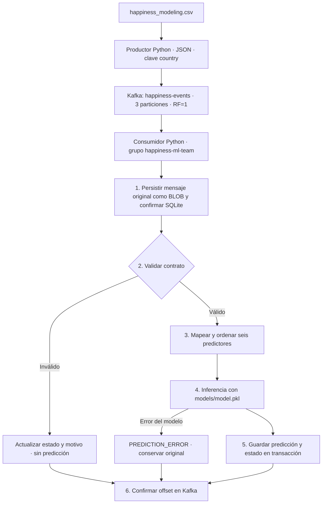

# Parte B — Streaming ETL con Apache Kafka

## 1. Alcance y arquitectura local

Esta etapa publica el histórico preparado como eventos individuales y ejecuta inferencia al recibirlos. Se utiliza **Apache Kafka 4.4.0**, un productor Python, un consumidor Python y una base **SQLite**. Kafka se ejecuta mediante Docker Compose; los procesos Python utilizan el entorno virtual del proyecto en Windows.



El broker utiliza KRaft en modo combinado: broker y controlador en el mismo contenedor. El puerto publicado es `127.0.0.1:9092`; los contenedores usan `kafka:19092`. El volumen `kafka-data` conserva registros y offsets. `kafka-storage-init` prepara los permisos del volumen y `kafka-init` crea el tópico después de comprobar la salud del broker. Los clientes Python también verifican las **3 particiones y replicación 1** al iniciar. No se modifica silenciosamente un tópico existente con otra configuración.

Se utiliza SQLite para mantener una instalación local verificable sin añadir otro servidor. La base se crea automáticamente en `data/streaming/happiness.db`, con WAL, claves foráneas y confirmación durable. Es una implementación local; compartir este archivo en un sistema distribuido no forma parte del diseño.

## 2. Contrato del evento

El contrato se declara en [event.schema.json](event.schema.json) y se aplica en [contract.py](contract.py). El esquema es documentación estructural; la validación de negocio de Python también comprueba valores finitos, fechas reales, tipos estrictos, clave Kafka y unicidad de identificadores en la base. Kafka transporta bytes y no sustituye estas comprobaciones.

```json
{
  "event_id": "E001",
  "country": "Colombia",
  "year": 2019,
  "gdp": 1.2,
  "family": 0.8,
  "health": 0.9,
  "freedom": 0.6,
  "generosity": 0.3,
  "corruption": 0.1,
  "actual_happiness_score": 6.2,
  "event_time": "2026-10-30T15:30:00"
}
```

| Campo | Regla implementada |
| --- | --- |
| `event_id` | String Unicode válido, no vacío. El productor genera `E<UUID_de_ejecución>-<secuencia>` para evitar colisiones entre ejecuciones. El ejemplo `E001` también es aceptado. |
| `country` | String Unicode válido, no vacío. La clave Kafka debe ser exactamente su codificación UTF-8. |
| `year` | Entero de 2015 a 2019, período del histórico utilizado. No se aceptan booleanos, texto ni `2019.0`. Ampliar el período requiere actualizar el contrato de forma explícita. |
| Seis indicadores | Valores JSON numéricos, finitos, no negativos y representables para la inferencia con árboles. Se rechazan bool, null y texto numérico. El límite técnico superior es el máximo de float32, exclusivo. |
| `actual_happiness_score` | Número finito de 0 a 10. Se almacena para comparación; **no ingresa al modelo**. |
| `event_time` | Fecha y hora ISO-8601 real, separadas por `T`, con segundos. Acepta offset, `Z` o la forma sin zona del ejemplo. El productor emite UTC con offset `+00:00`; una hora entrante sin zona se conserva sin inferir una zona. |

Todos los campos son obligatorios. Se rechazan campos adicionales, claves JSON duplicadas, JSON mal formado, UTF-8 inválido y mensajes sin valor —tombstones—. Tampoco se permiten `NaN`, `Infinity` ni magnitudes que desborden la representación numérica del modelo. Los indicadores **no se restringen al intervalo [0,1]**: el histórico contiene valores mayores que uno.

Estas reglas comprueban validez técnica y semántica mínima; no garantizan que toda combinación numérica válida pertenezca a la distribución de entrenamiento.

### 2.1. Mapeo hacia el modelo

| Campo del evento | Columna de entrenamiento | Posición |
| --- | --- | --- |
| `gdp` | `gdp_per_capita` | 1 |
| `family` | `social_support` | 2 |
| `health` | `healthy_life_expectancy` | 3 |
| `freedom` | `freedom` | 4 |
| `generosity` | `generosity` | 5 |
| `corruption` | `corruption` | 6 |

El orden se comprueba contra `model_metadata.json` y `model.feature_names_in_`. Se construye un DataFrame con estas seis columnas y se llama a `pipeline.predict`: no se ajusta otro escalador ni se vuelve a entrenar el modelo. `country`, `year`, `event_id`, `event_time` y `actual_happiness_score` quedan fuera de la matriz predictora.

El artefacto es el Random Forest seleccionado por validación temporal y reentrenado con 2015–2019. Se registran su nombre y hash SHA-256 en cada predicción. **La simulación usa observaciones incluidas en ese reentrenamiento; sus errores no constituyen una evaluación independiente ni reemplazan la prueba temporal documentada en el README principal.**

## 3. Productor

[producer.py](producer.py) lee `happiness_modeling.csv` con `csv.DictReader`, fila a fila. Genera un identificador trazable y la hora de emisión, aplica el mapeo del contrato, serializa JSON UTF-8 y utiliza `country` como clave.

Se habilitan entrega idempotente del productor y `acks=all`. Cada mensaje se confirma antes de enviar el siguiente; una entrega fallida termina la simulación con error. El retardo entre registros se configura con `--delay`, en segundos. Esta decisión favorece trazabilidad para el ejercicio, no rendimiento masivo. La clave mantiene los eventos de un país en la misma partición; no existe orden global entre las tres particiones.

Cada nueva ejecución genera identificadores nuevos y representa otra simulación. La idempotencia del cliente evita duplicados causados por sus reintentos de transporte; no elimina nuevas publicaciones deliberadas del histórico.

## 4. Consumidor y persistencia

[consumer.py](consumer.py) utiliza obligatoriamente el grupo **`happiness-ml-team`**. La carga del modelo y la comprobación de versiones se realizan una vez, antes de empezar a recibir mensajes.

Por cada mensaje:

1. Inserta y confirma el mensaje original en `raw_happiness_events`, sin deserializar todavía.
2. Valida JSON, campos, tipos, valores, timestamp y correspondencia de la clave.
3. Comprueba la unicidad de `event_id` entre eventos que superaron el contrato.
4. Reconstruye los seis predictores en el orden entrenado y ejecuta la inferencia.
5. Guarda predicción, entradas, valor real, error, identificación del modelo y estado final. Resultado, reserva de identificador y estado se confirman en una misma transacción.
6. Confirma de forma síncrona el offset de Kafka, tanto para válidos como para inválidos persistidos.

### 4.1. Tablas

El esquema se encuentra en [sql/streaming.sql](../sql/streaming.sql).

| Tabla | Contenido y función |
| --- | --- |
| `raw_happiness_events` | Valor y clave originales como BLOB, incluyendo bytes que no sean UTF-8 o valores nulos. Conserva tópico, partición, offset, timestamp Kafka, recepción, estado y motivo. Los headers se conservan en una lista ordenada con valores base64, admitiendo claves repetidas y valores nulos. |
| `event_claims` | Reserva única de identificadores de eventos que superaron el contrato. Impide otra predicción para el mismo `event_id` en una posición Kafka distinta. |
| `happiness_predictions` | Una predicción por evento: país, edición, timestamp, entradas ordenadas, puntaje real, predicho, residuo, error absoluto y versión del modelo por hash. |

El valor original **no se almacena como JSON reconstruido**: hacerlo cambiaría espacios, orden o representación. Se guardan exactamente los bytes entregados por la API de Kafka. Un trigger impide actualizar los campos originales; solo cambian los metadatos de procesamiento. La conversión a texto en una consulta no altera el BLOB.

### 4.2. Estados

| Estado | Significado | ¿Se guarda predicción? |
| --- | --- | --- |
| `RECEIVED` | Original persistido, procesamiento aún no finalizado. Puede quedar así si falla la infraestructura. | No todavía. |
| `VALID` | Contrato aceptado, inferencia y resultado guardados correctamente. | Sí. |
| `INVALID_SCHEMA` | JSON, campos o tipos incorrectos; también incluye valor nulo o UTF-8 inválido. | No. |
| `INVALID_VALUES` | Valores fuera del contrato, fecha inválida, clave discordante o `event_id` duplicado. | No. |
| `PREDICTION_ERROR` | El contrato es válido, pero falla la inferencia o el modelo devuelve un resultado no finito. | No. |

Los errores de un registro no detienen el procesamiento de los siguientes. Un fallo de infraestructura —por ejemplo, no poder escribir en la base— sí detiene el consumidor **sin confirmar ese offset**, para evitar pérdida silenciosa de auditoría.

### 4.3. Reinicios, duplicados y reprocesamiento

Kafka y SQLite no participan en una transacción distribuida. Se implementa entrega **al menos una vez** con persistencia idempotente:

- La clave única `(topic, partition_id, offset_id)` evita insertar dos veces un mensaje redeliverado.
- Si su estado final ya existe, no se repite la inferencia y se confirma el offset.
- Si solo se guardó el original y sigue en `RECEIVED`, el reinicio continúa su procesamiento.
- Si otro mensaje reutiliza un `event_id` ya reservado, se guarda su original y se marca `INVALID_VALUES`.

Los estados finales no se reintentan automáticamente. Los originales permiten construir un reprocesamiento explícito en una etapa posterior, incluso para `PREDICTION_ERROR`; esa herramienta todavía no se implementa. Deben conservarse juntos el volumen Kafka y la base: borrar y recrear el tópico reinicia sus offsets, que pueden colisionar con auditorías antiguas. No se debe recrear el tópico ni reiniciar offsets como procedimiento habitual.

## 5. Ejecución desde PowerShell

Ejecutar desde la raíz del repositorio, con Docker Desktop iniciado y el kernel Linux disponible. No se requiere una instalación local de Java: Kafka y sus herramientas CLI están dentro del contenedor.

### 5.1. Preparar dependencias y tópico

```powershell
.venv\Scripts\python.exe -m pip install -r kafka/requirements.txt
docker compose up -d
docker compose ps -a
docker compose logs kafka-init
.venv\Scripts\python.exe -m kafka.topic
```

`kafka/requirements.txt` fija las versiones numéricas usadas por el pickle existente. El consumidor verifica scikit-learn, NumPy, pandas y SciPy contra sus metadatos. Si se reentrena con otras versiones, hay que actualizar conjuntamente artefacto, metadatos y dependencias de inferencia.

El resultado esperado de `kafka.topic` es: `happiness-events: 3 particiones, replicación 1`. Los inicializadores terminan con código 0; el broker debe permanecer `healthy`.

### 5.2. Iniciar consumidor — terminal 1

```powershell
.venv\Scripts\python.exe -m kafka.consumer
```

Este proceso espera continuamente y se detiene con `Ctrl+C`. Para una sesión acotada:

```powershell
.venv\Scripts\python.exe -m kafka.consumer --max-messages 10 --idle-timeout 20
```

`--max-messages` cuenta todos los mensajes procesados, incluidos los inválidos. `--idle-timeout` permite terminar si no llegan eventos; sin esta opción, el consumidor sigue esperando. Se inicia desde el offset confirmado del grupo; `earliest` solo aplica cuando todavía no existe uno.

### 5.3. Iniciar productor — terminal 2

```powershell
.venv\Scripts\python.exe -m kafka.producer --delay 0.1
```

Publica los 782 registros históricos. Para una demostración corta:

```powershell
.venv\Scripts\python.exe -m kafka.producer --delay 0.25 --limit 10
```

El productor conserva el orden de lectura del CSV y genera una hora de emisión nueva para cada registro. El tiempo histórico corresponde a `year`; `event_time` corresponde al momento actual de publicación simulada.

### 5.4. Consultar resultados

```powershell
.venv\Scripts\python.exe -m kafka.inspect --limit 5
docker compose exec -T kafka /opt/kafka/bin/kafka-consumer-groups.sh --bootstrap-server kafka:19092 --describe --group happiness-ml-team
```

El primer comando muestra estados y predicciones de SQLite; el segundo permite revisar offsets y lag. Las consultas adicionales están en [streaming_queries.sql](../sql/streaming_queries.sql). `CAST(raw_value AS TEXT)` solo debe utilizarse para inspeccionar mensajes textuales: puede haber bytes inválidos que deben consultarse como BLOB.

Se admiten `KAFKA_BOOTSTRAP_SERVERS` y `HAPPINESS_DATABASE` como variables de entorno. Los argumentos `--bootstrap-servers` y `--database` permiten sobrescribirlos; `--data`, `--model` y `--metadata` permiten indicar rutas explícitas. No se carga `.env` automáticamente en los procesos Python.

### 5.5. Detener el entorno

Detener productor y consumidor con `Ctrl+C`, y después:

```powershell
docker compose down
```

Este comando conserva el volumen Kafka. La base también permanece en `data/streaming/`. No utilizar `down -v` para detener rutinariamente la demostración, porque eliminaría los datos persistidos del broker.

## 6. Verificación

Pruebas locales de contrato, almacenamiento y modelo real:

```powershell
.venv\Scripts\python.exe -m unittest discover -s tests -v
```

Cubren campos ausentes, tipos, rangos, NaN/Infinity, timestamp, clave, bytes inválidos, original confirmado antes de deserializar, inmutabilidad, errores de inferencia, reinicios y duplicados. Se compara la inferencia del evento contra el pickle sobre los mismos datos y se comprueba que cambiar el valor real no cambie la predicción.

La prueba de integración es optativa y requiere el broker activo. **Detener otros consumidores del mismo grupo antes de ejecutarla**: utiliza `happiness-ml-team` y conserva evidencia en la base del ejercicio.

```powershell
$env:RUN_KAFKA_INTEGRATION = '1'
.venv\Scripts\python.exe -m unittest discover -s tests -p test_kafka_integration.py -v
Remove-Item Env:RUN_KAFKA_INTEGRATION
```

La integración publica y consume simultáneamente el histórico completo; después introduce ocho mensajes inválidos y un válido posterior. Comprueba conservación de bytes, distribución por clave, coincidencia con inferencia por lotes y ausencia de redelivery tras reiniciar el consumidor con sus offsets confirmados. La evidencia se exporta a [verification.json](../data/reports/streaming/verification.json).

Las bases y sus archivos WAL quedan excluidos de Git; el esquema, el código y el informe de verificación permiten reproducir el resultado.

### 6.1. Resultado de la verificación realizada

| Comprobación | Resultado |
| --- | --- |
| Pruebas locales de contrato, persistencia e inferencia | 18 pruebas aprobadas. |
| Integración con Kafka real | Aprobada; 782 eventos históricos y 9 eventos de comprobación. |
| Mensajes originales almacenados | 791. |
| Predicciones guardadas | 783: 782 del histórico y una de control posterior a los inválidos. |
| Rechazos auditados | 4 `INVALID_SCHEMA` y 4 `INVALID_VALUES`; sin predicción. |
| Recuperación del grupo consumidor | Cero mensajes redeliverados sin nuevas publicaciones; lag final cero en las tres particiones. |

El tratamiento de `PREDICTION_ERROR` se verifica mediante un fallo de inferencia simulado en las pruebas locales. No se altera el modelo real para provocar un fallo en la prueba del broker. Los conteos anteriores corresponden a la ejecución registrada en el informe; nuevas simulaciones agregan nuevos eventos y predicciones.

## 7. Referencias

- [Apache Kafka: imagen oficial y configuración Docker](https://hub.docker.com/r/apache/kafka).
- [Apache Kafka: ejemplo oficial de listeners internos y externos](https://github.com/apache/kafka/blob/trunk/docker/examples/docker-compose-files/single-node/plaintext/docker-compose.yml).
- [Confluent: cliente Python y confirmación manual de offsets](https://docs.confluent.io/kafka-clients/python/current/index.html).
